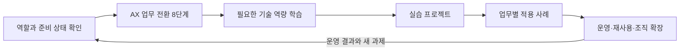

# AX Engineer Roadmap

[한국어](README.md) | [English](en/README.md)

**AX Engineer**는 자동화하거나 AI로 보조할 업무를 찾고, 사람이 판단할 지점을 남겨 흐름을 다시 설계한 뒤, AI가 허용된 권한 안에서 기존 데이터와 시스템을 사용하도록 구현하고 실제 운영까지 책임지는 엔지니어다.

이 저장소에서 **AX**는 조직의 업무 흐름을 AI로 다시 설계하고 운영 방식까지 바꾸는 **AI Transformation**을 뜻한다. 업계 전체에서 하나로 합의된 약어라고 전제하지 않는다.

> AX 엔지니어의 일은 데모가 동작할 때 끝나지 않는다.
>
> 실제 사용자가 업무에 적용하고, 문제가 생기면 멈추거나 복구하며, 다른 사람이 이어서 운영할 수 있어야 한다.

## 이 로드맵에서 다루는 것

- **업무 전환 순서**: 문제와 자동화 범위를 정하고 업무를 다시 설계한 뒤, 필요한 데이터를 준비해 통제·배포·현업 적용·확장까지 8단계로 진행한다.
- **구현과 운영 기준**: 각 역량을 어떤 결과물로 입증하고, 승인·기록·복구를 어떻게 운영할지 제시한다.
- **업무별 적용 사례**: 공통 업무와 6개 산업 맥락의 15개 사례에서 원본 시스템과 실행 범위를 비교한다.
- **외부 공개 사례 카탈로그**: 국내 10개, 해외 15개 사례에서 실제 업무 흐름, 사람의 판단 지점, 공개 성과와 근거 한계를 비교한다.
- **역할별 시작점**: 현직 AX 엔지니어와 준비하는 사람, 현업 실무자, 리더, 데이터·보안·운영 담당자가 결정하거나 확인할 내용을 구분한다.

## 지금 검증된 범위

| 자산 | 수량 | 공개 근거의 의미 |
|---|---:|---|
| 업무별 사례 | 15개 | 모두 문서·메타데이터 검사를 통과한 실습 설계 |
| 재현 가능한 공개 시뮬레이션 | 1개 | 합성 VOC 16건을 처리하는 코드·평가·실행 안내서·해시 목록을 빈 작업 디렉터리에서 다시 검증 |
| 실행 전 설계 문서 | 14개 | 원본 시스템·승인·실패·복구를 설계했지만 실행 코드나 조직 운영 성과는 아직 없음 |
| 외부 공개 사례 | 국내 10개·해외 15개 | 기존 원문 26개와 후속 근거 3개를 구분하고 출처·도입 단계·성과 검증을 기록 |

`ready`는 사례 문서가 실습에 사용할 수 있다는 뜻이다. 조직의 실제 도입, 운영 성과, 생산성·비용·매출 효과를 검증했다는 뜻이 아니다.

VOC 16건 데모는 P1에 해당하는 일부 기능을 구현한 예다. [P1](projects/01-safe-assistant.md)의 최소 20개 평가, 규칙·모델 비교와 새 입력 독립 검수까지 통과한 사례로 보지 않는다. 사례의 현재 P 표시는 구현이 있는 단계를 가리키며 전체 통과 여부는 별도로 확인한다.

## 내 시작점 찾기

1. [역할과 책임 범위](roadmap/role-model.md)에서 AX Engineer가 맡는 결정과 경계를 확인한다.
2. [조직 준비도 진단](start-here/organization-readiness.md)에서 현재 업무가 파일·메신저, SaaS, 사내 시스템 중 어디까지 준비됐는지 확인한다.
3. 아래 업무별 적용 사례에서 접근 가능한 데이터와 테스트 환경이 있는 사례를 하나 고른다.

[Markdown 시작 안내](start-here/README.md)

## 어떤 업무부터 자동화하거나 보조할까

익숙한 업무에서 사례 하나를 골라 시작한다. 사례 이름을 누르면 원본 시스템, 담당자 승인, 외부 시스템에 미치는 영향, 실패했을 때 복구하는 방법을 확인할 수 있다.

| 업무 영역 | 사례 | 시작 조건 | 목표 실행 범위 |
|---|---|---|---|
| 고객·매출 | [합성 VOC 반복 문제 → 개선 업무 제안](case-studies/beauty-d2c-voc/README.md) | 합성 VOC | 승인 후 샌드박스에 쓰기 |
| 고객·매출 | [공공 민원 → 근거 답변·중복 묶음](case-studies/public-service-petition-response/README.md) | 합성 민원·정책 | 초안 전용 |
| 사람·협업 | [Slack 회의 기록에서 승인할 후속 업무 찾기](case-studies/slack-meeting-actions/README.md) | SaaS 샌드박스 | 승인 후 기록 |
| 사람·협업 | [입사·이동·퇴사 계정·권한 관리](case-studies/employee-lifecycle-access/README.md) | HR·계정 샌드박스 | 역할별 승인 후 반영 |
| 재무·구매 | [법인카드 거래·영수증 → 전표 초안](case-studies/corporate-card-expense/README.md) | 합성 거래·증빙 | 초안 전용 |
| 재무·구매 | [전자세금계산서 발행·입금 대사](case-studies/electronic-tax-invoice-reconciliation/README.md) | 회계·ERP 샌드박스 | 승인 후 테스트 발행 |
| 재무·구매 | [거래처 등록·계좌 변경 검증](case-studies/vendor-master-account-change/README.md) | 거래처 마스터 샌드박스 | 이중 승인 후 반영 |
| 재무·구매 | [기업 자료 → 여신·인수심사 검토 초안](case-studies/credit-underwriting-review/README.md) | 합성 신청·심사 규칙 | 초안 전용 |
| 데이터·운영 | [파일·CSV → 검토 가능한 업무 허브(AX Hub)](case-studies/file-csv-to-ax-hub/README.md) | 파일·메신저 | 초안 전용 |
| 데이터·운영 | [재고 예외 → 발주·창고 이동안](case-studies/inventory-exception-replenishment/README.md) | ERP·WMS 샌드박스 | 승인 후 제안 기록 |
| 데이터·운영 | [설비 이상 → 정비 제안](case-studies/equipment-anomaly-maintenance/README.md) | 합성 센서·CMMS 샌드박스 | 승인 후 제안 기록 |
| 데이터·운영 | [상담·진료 대화 → 기록·위험 이관](case-studies/care-conversation-record/README.md) | 허구 대화·기록 샌드박스 | 초안·사람 이관 |
| 데이터·운영 | [근거 자료 → 출처 연결 규제 문서](case-studies/regulated-evidence-document/README.md) | 합성 계약·연구 자료 | 초안 전용 |
| 공통 운영 | [여러 업무가 함께 쓰는 메일 보조](case-studies/centralized-mail-assist/README.md) | 메일 샌드박스 | 발송 전 승인 |
| 공통 운영 | [여러 업무를 위한 에이전트 운영 기반](case-studies/company-agent-operating-layer/README.md) | 두 번째 업무·사내 API | 업무별로 제한 |

위 표의 마지막 열은 현재 구현 범위가 아니라 **사례에서 연습하도록 정한 최대 실행 범위**다. 현재 실행 범위와 목표 범위, 준비 상태, 난이도와 위험, P1~P5는 [전체 사례 비교표](case-studies/README.md)에서 따로 확인할 수 있다.

다른 조직이 공개한 사례에서 더 다양한 업무 후보를 찾고 싶다면 [공개 AX 사례 카탈로그](research/public-ax-cases.md)를 참고한다. [공개 사례-실습 연결표](research/public-case-application-map.md)에서는 25개 공개 사례에서 가져온 질문과 통제 방식을 기존 10개 및 신규 5개 실습 중 어디에 반영했는지 확인할 수 있다. 외부 발표는 참고 자료이며, 이 저장소가 해당 조직의 운영 성과를 검증했다는 뜻이 아니다.

**AX Hub**는 흩어진 파일·CSV의 원본, 담당자와 검토 상태를 확인하는 작은 업무 허브를 뜻한다. 사례 제목에서 특정 회사의 내부 진단, 실제 도입이나 시간·비용·매출 개선을 추정하지 않는다.

## 로드맵 구성

1. [시작점 안내](start-here/README.md): 현재 맡은 책임과 업무 준비 상태를 확인한다.
2. [AX 업무 전환 8단계](delivery-lifecycle/README.md): 자동화하거나 AI로 보조할 업무를 찾고, 사람이 판단할 지점을 남겨 흐름을 다시 설계한 뒤 실제 환경에 배포하고 업무에서 운영한다.
3. [AX 엔지니어의 기술 역량](technical-foundations/README.md): 소프트웨어·LLM·에이전트·평가·운영·보안을 학습한다.
4. [실습 프로젝트](projects/README.md): 안전한 보조 도구를 만들고, 두 번째 업무에서 재사용할 부분까지 검증한다.
5. [업무별 적용 사례](case-studies/README.md): 준비 상태와 위험에 맞는 사례를 골라 그 사례가 다루는 P단계를 연습한다. 나머지 단계는 별도 실습으로 확인한다.
6. [운영과 조직 확장](organization-maturity/README.md): 여러 업무에서 같은 운영 능력을 반복할 수 있는지 확인한다.

P3의 [UI 통합](toolkit/ui-integration-checklist.md)과 P5의 [Skills 재사용](toolkit/reusable-skill-card.md)은 업무에 맞을 때 선택한다. [표준과 제안의 검토 목록](research/standards-watchlist.md)에서 계획과 실제 지원을 구분한다. 선택 실습을 문서에 추가한 것이 구현 완료를 뜻하지는 않는다.

## AX 업무 전환 8단계

8단계를 순서대로 밟되, 운영 결과나 새로운 제약이 발견되면 앞 단계로 돌아가 다시 확인한다.

| 단계 | 핵심 질문 | 문서 |
|---|---|---|
| 1. 목표와 경계 | 무엇을 자동화하거나 AI로 보조하고, 무엇은 사람이 판단하거나 직접 처리하는가? | [보기](delivery-lifecycle/01-outcomes-and-boundaries.md) |
| 2. 현재 업무 파악 | 실제 흐름과 병목은 어디에 있는가? | [보기](delivery-lifecycle/02-workflow-discovery.md) |
| 3. 업무 흐름 재설계 | 없애거나 단순화할 일을 그대로 자동화하고 있지 않은가? | [보기](delivery-lifecycle/03-process-redesign.md) |
| 4. 데이터와 업무 맥락 | 최신 상태를 어디에서 확인하며, 팀마다 용어를 같은 뜻으로 쓰는가? | [보기](delivery-lifecycle/04-data-and-context.md) |
| 5. 실행 규칙과 통제 | 입력·출력·권한·승인·기록·복구 기준은 무엇인가? | [보기](delivery-lifecycle/05-execution-contracts.md) |
| 6. 배포와 운영 | 프로토타입을 어떻게 안정적인 업무 시스템으로 옮기는가? | [보기](delivery-lifecycle/06-production-deployment.md) |
| 7. 현업 적용과 역할 전환 | 새 방식이 공식 업무로 자리 잡으려면 무엇이 바뀌어야 하는가? | [보기](delivery-lifecycle/07-adoption-and-change.md) |
| 8. 표준화와 확장 | 두 번째 업무에서도 실제로 재사용할 수 있는 것은 무엇인가? | [보기](delivery-lifecycle/08-standardization-and-scale.md) |

## 역량을 확인하는 다섯 질문

개념을 아는 것만으로는 역량을 확인하기 어렵다. 각 역량에 대해 아래 질문에 답할 수 있는지, 그 답을 결과물과 운영 기록으로 보여 줄 수 있는지 확인한다.

1. **이해** — 개념과 원리를 자신의 말로 설명할 수 있는가?
2. **선택** — 조건과 위험을 비교해 이 방법을 선택한 이유를 설명할 수 있는가?
3. **적용** — 실제 업무와 비슷한 데이터·권한·예외 조건에서 직접 적용했는가?
4. **검증** — 다른 사람이 검토하거나 재현할 수 있는 결과물과 기록을 남겼는가?
5. **실패 대응** — 자주 발생하는 오판과 실패를 발견하고, 필요할 때 중단하거나 복구할 수 있는가?

숙련도는 연차나 사용해 본 도구의 수보다 맡을 수 있는 배포·운영 책임으로 구분한다.

- **Foundation(기초)**: 업무를 구조화하고 제한된 프로토타입을 검증한다.
- **Builder(구현)**: 한 업무를 실제 운영 환경에 배포한다.
- **Operator(운영)**: 품질·비용·장애·권한을 관리하고, 사용자가 새 절차를 계속 쓰는지 확인한다.
- **Lead(확장)**: 여러 업무에서 반복되는 규칙을 찾아 조직의 공통 운영 방식으로 만든다.

[역량 체계](roadmap/competency-map.md) · [숙련도 기준](roadmap/proficiency-levels.md)

## 어디서 시작할까

### AX 엔지니어 또는 이 직무를 준비하는 사람

1. [역할 모델](roadmap/role-model.md)에서 책임과 경계를 확인하고 [경험별 진입 경로](learning-paths/entry-routes.md)에서 첫 결과물과 검수 조건을 고른다.
2. [조직 준비도 진단](start-here/organization-readiness.md)으로 첫 업무에서 가능한 범위를 정한다.
3. [기술 역량](technical-foundations/README.md)에서 부족한 영역을 찾는다.
4. [12주 실습 경로](learning-paths/12-week-practice.md)에서 조직 실전 또는 공개 시뮬레이션을 선택해 한 업무의 운영 조건과 두 번째 업무의 재사용을 검증한다.

### 함께 일하는 현업·리더·데이터·보안·운영 담당자

[협업 역할 안내](tracks/README.md)에서 자신이 결정하거나 제공해야 할 내용을 찾는다. 코드를 직접 작성하지 않더라도 업무 기준, 데이터 사용, 승인, 운영, 중단에 대한 책임은 역할별로 나뉜다.

### 기술 용어가 낯선 사람

[비개발자를 위한 AX 용어 안내](start-here/non-developer-glossary.md)에서 LLM, RAG, 에이전트(Agent), MCP, 평가, 로그, 수동 대체를 실제 업무 장면에 맞춰 설명한다.

## 공통 운영 기반(harness)은 언제 만드는가

**공통 운영 기반(harness)**: 여러 업무가 함께 지키는 최소 운영 규칙과 재사용 도구의 묶음이다.

팀마다 같은 모델·프레임워크·화면을 쓸 필요는 없다.

- 최신 데이터를 확인할 원본 시스템
- 입력·출력 형식과 업무 식별자
- 품질 기준과 담당자 승인
- 권한·변경·버전·감사 기록
- 실패 감지, 중단, 복구, 수동 처리
- 비용·품질·업무 결과 확인 방법

첫 업무의 구현을 곧바로 전사 표준으로 만들지는 않는다. 두 번째 업무에서도 실제로 재사용한 규칙과 도구만 공통 운영 기반에 포함한다.

## 다루지 않는 범위

- 특정 모델·클라우드·에이전트 프레임워크의 순위
- 모든 업무를 AI가 처리하는 조직 설계
- 하나의 에이전트에 전사 데이터와 권한을 집중하는 구조
- 확인되지 않은 생산성·비용·매출 개선 수치
- 자격증 과정이나 채용 보장

## 한국 조직에서 따로 확인할 것

업무 발굴, 재설계, 데이터 통합, 평가, 운영 원칙은 지역과 업종이 달라도 쓸 수 있다. 여기에 한국 조직에서 자주 확인해야 할 조건을 따로 더했다.

- 문서상의 결재선과 실제 의사결정권이 다른가?
- 개인정보와 AI 관련 현재 법령을 누가 확인하는가?
- 회사와 부서마다 데이터·API·조직 계정의 준비 정도가 얼마나 다른가?
- 도구 구매 뒤 공식 업무 절차와 책임까지 바뀌는가?
- 공급자를 바꾸거나 계약을 종료할 때 데이터와 업무를 되돌릴 수 있는가?

한국 기업 전체가 같은 방식으로 일한다고 가정하지 않는다. 다른 지역에서는 법률·조달·노사관계·조직 구조에 해당하는 조건을 현지 상황에 맞춰 바꿔 쓰면 된다.

## 공개 채용 자료에서 확인한 역할

`AX Engineer`는 아직 업계에서 하나로 굳어진 직함이 아니다. 2026-07-23 역할 조사를 기준으로 2026-10-26에 공식 채용·교육 자료를 다시 검토했다. AX 외의 직함에서도 업무 통합, 평가, 승인, 운영과 인수인계 책임을 확인했다. 현재 공고, 종료된 공고, 날짜를 확인하지 못한 자료는 [AX Engineer 공개 역할 검토](research/ax-engineer-role-review.md)에서 구분한다. 이 표본으로 채용 증가율이나 평균 연봉을 추정하지 않는다.

이번 문서 보강은 MCP 기준 버전, 장기 작업의 중단·재개, 권한 회수, 실제 시스템 결과 평가와 완료 업무당 비용을 다룬다. 실습 절차가 늘어났어도 공개 구현 범위는 시뮬레이션 1개와 설계 문서 14개로 유지한다. 공개 사례는 K04·K05·K07·K08·K09·G02·G07·G08·G10의 후속·정정 주장을 기록했다. 확인한 원문의 지표·단위·도입 단계를 대조한 것이며 25개 전체의 현재 운영을 다시 검증한 것은 아니다.

## 기여하기

[공개 AX 사례 카탈로그](research/public-ax-cases.md)는 국내외 25개 사례를 업무 흐름과 통제 관점에서 비교한다. [AX Engineer 공개 역할 검토](research/ax-engineer-role-review.md)는 현재 채용·현장 자료에서 반복되는 책임을 설명한다. [개발자·AI Agent 로드맵 검토](research/roadmap-benchmark-review.md)는 roadmap.sh에서 참고한 구조와 AX 관점에서 추가한 내용을 기록한다.

- 잘못되거나 오래된 내용은 `Source update` Issue로 제안한다.
- 빠진 역량이나 단계를 발견하면 `Roadmap gap` Issue를 연다.
- 실제 사례는 조직과 개인을 식별할 수 없게 정리한 뒤 `Case study proposal`로 제안한다.
- 모든 기여는 [기여 안내](CONTRIBUTING.md)를 따르고 안내된 로컬 검증 절차를 거치며, [출처 정책](research/source-policy.md)을 지킨다.

[지원과 질문](SUPPORT.md) · [보안 정책](SECURITY.md) · [프로젝트 운영](GOVERNANCE.md) · [행동강령](CODE_OF_CONDUCT.md) · [변경 기록](CHANGELOG.md) · [인용 정보](CITATION.cff)

## 이 프로젝트를 만든 이유

이 프로젝트는 제품 엔지니어로 일하며 AI 기능을 만드는 일과 조직의 실제 업무를 바꾸는 일 사이에 남는 간극을 정리하려고 시작했다. 유지관리자 [Woogi](https://github.com/woogi-kang)는 사례 문서와 실행 가능한 코드·검증 자료를 직접 만들고 검증하며, 공개 자료로 확인할 수 없는 조직 성과나 운영 경험은 시뮬레이션과 분리해 표시한다.

## 상태와 라이선스

- 공개 릴리스 기록: `v0.3.0`
- 다음 릴리스 후보: `v0.4.0`
- 문서 검토일: `2026-10-26` (출처별 확인일과 실제 관측기간은 연구 문서에 별도 기록)
- 상태: `v0.4.0` 릴리스 준비본. 로컬 변경은 `main`에 반영되기 전까지 공개 저장소에 나타나지 않는다.
- 적용 범위: 여러 조직에 적용할 AX 원칙과 한국 조직에서 확인할 조건
- 라이선스: [MIT](LICENSE)
