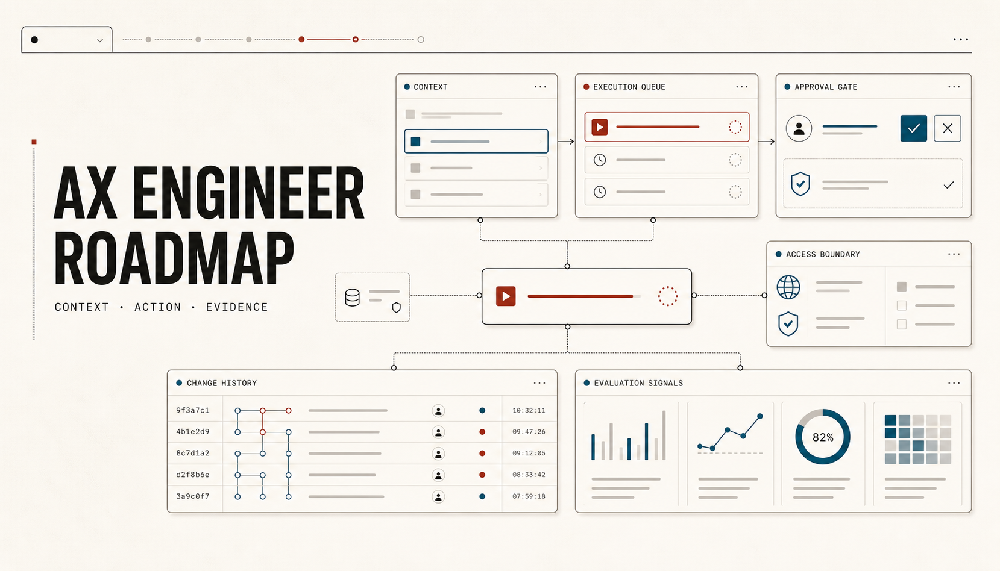
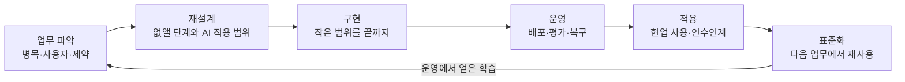
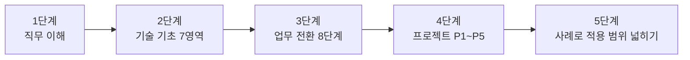

  

# AX Engineer Roadmap

[한국어](README.md) · [English](en/README.md)

**AX 엔지니어**는 업무에서 AI가 도울 부분을 찾고, 기존 시스템에 연결해 직접 구현·평가·운영하는 엔지니어입니다. 업무 책임자와 함께 무엇을 자동으로 처리하고 어디서 사람이 판단할지도 정합니다.

이 저장소는 AX 엔지니어를 준비하는 주니어와 직무 전환자를 위한 로드맵입니다. **직무를 이해하고, 필요한 역량을 익히고, 실제 업무를 바꾸는 프로젝트를 완성하는 순서**를 단계별로 안내합니다. AX는 AI Transformation을 뜻하며 회사마다 직함과 책임 범위가 다릅니다.

> [!TIP]
> 처음이라면 [나에게 맞는 시작점](#나에게-맞는-시작점)에서 내 경험과 가까운 경로를 하나 고르세요. 전체 그림을 먼저 보고 싶다면 [로드맵 한눈에 보기](#로드맵-한눈에-보기)로 이동하세요.

## 목차

- [AX 엔지니어는 어떤 일을 하나요?](#ax-엔지니어는-어떤-일을-하나요)
- [나에게 맞는 시작점](#나에게-맞는-시작점)
- [로드맵 한눈에 보기](#로드맵-한눈에-보기)
  - [1단계. 직무 이해하기](#1단계-직무-이해하기)
  - [2단계. 기술 기초 익히기](#2단계-기술-기초-익히기)
  - [3단계. 업무를 바꾸는 순서 익히기](#3단계-업무를-바꾸는-순서-익히기)
  - [4단계. 프로젝트로 결과물 만들기](#4단계-프로젝트로-결과물-만들기)
  - [5단계. 사례로 적용 범위 넓히기](#5단계-사례로-적용-범위-넓히기)
- [실무 템플릿](#실무-템플릿)
- [자주 묻는 질문](#자주-묻는-질문)
- [자료 원칙과 참여 방법](#자료-원칙과-참여-방법)

## AX 엔지니어는 어떤 일을 하나요?

AX 엔지니어의 일은 프로토타입이 동작할 때 끝나지 않습니다. 업무 결과를 확인할 사람과 운영을 맡을 사람이 정해지고, 그들이 안전하게 이어받을 수 있어야 한 업무의 전환이 마무리됩니다.

| 하는 일 | 혼자 결정하지 않는 일 |
|---|---|
| 업무 병목을 찾고 기술 범위를 정한다 | 전사 AI 전략과 성과 목표 확정 |
| 데이터·시스템을 연결하고 직접 구현·배포한다 | 데이터 소유자 대신 원본 기준 결정 |
| 평가·보안·관측·복구를 만든다 | 보안·법무 담당자 대신 위험 예외 승인 |
| 현업 적용과 운영 인수인계를 설계한다 | 사용자의 수동 업무를 영구적으로 대신하기 |

[역할 모델 자세히 보기](roadmap/role-model.md) · [공고에서 확인한 역할](research/ax-engineer-role-review.md) · [공고로 보는 직무 해설](research/hiring-signals.md) · [월간 채용 현황](research/hiring-monthly/README.md)

## 나에게 맞는 시작점

어느 경로든 첫 실습은 P1입니다. 기존 경력이 있어도 단계별 통과 기준은 그대로 적용합니다.

| 지금 나는 | 먼저 볼 문서 | 첫 결과물 예시 |
|---|---|---|
| 개발 경력이 짧거나 처음 구현한다 | [경험별 진입 경로 1](learning-paths/entry-routes.md#1-개발-경력이-짧거나-처음-구현하는-사람) → [P1](projects/01-safe-assistant.md) | 공개 매뉴얼에 출처를 붙여 답하거나 답을 거절하는 보조 기능 |
| 웹·백엔드·데이터 개발 경험이 있다 | [경험별 진입 경로 2](learning-paths/entry-routes.md#2-기존-개발-경험으로-ax-업무를-맡으려는-사람) → [AX 엔지니어 실행 경로](tracks/ax-builder.md) | 합성 요청 분류 서비스와 평가 기록 |
| 업무 도메인은 잘 알지만 개발 경험이 적다 | [경험별 진입 경로 3](learning-paths/entry-routes.md#3-도메인-경험을-가진-사람) → [현업 실무자 협업 안내](tracks/business-practitioner.md) | 합성 정산 요청의 누락 증빙·검토 근거표 |
| API, RAG, MCP 같은 용어부터 낯설다 | [비개발자를 위한 용어 안내](start-here/non-developer-glossary.md) | API·RAG·MCP가 업무에서 어떤 장면인지 이해하기 |
| 일단 코드를 돌려 보고 싶다 | [합성 VOC 실행 안내](case-studies/beauty-d2c-voc/RUNBOOK.md) | 공개된 실행 결과 재현(외부 계정·API 불필요) |

직함보다 실제로 맡을 결정이 무엇인지 헷갈린다면 [역할 선택 안내](start-here/persona-selector.md)를 먼저 확인하세요.

## 로드맵 한눈에 보기

각 단계에는 읽을 문서와 스스로 점검할 항목이 있습니다. 점검 항목은 다음 단계로 넘어가기 전에 확인할 질문이며, 숙련도 인증을 뜻하지 않습니다.

### 1단계. 직무 이해하기

AX 엔지니어가 맡는 책임과 회사마다 다른 역할 범위를 파악합니다. 공고는 확인일이 있는 조사 기록이므로 현재 모집 상태는 원문에서 다시 확인하세요.

| 문서 | 여기서 얻는 것 |
|---|---|
| [역할 모델](roadmap/role-model.md) | 책임의 범위, 세 가지 운영 모델, 역할 경계 |
| [공개 역할 검토](research/ax-engineer-role-review.md) | 공고에서 업무 발굴·구현·운영·현업 지원이 나뉘는 방식 |
| [역량 체계](roadmap/competency-map.md) | 사업성·업무·데이터·통합·AI·운영·적용·조직 학습 8영역 |
| [숙련도 기준](roadmap/proficiency-levels.md) | Foundation → Builder → Operator → Lead 판단 기준 |

- [ ] AX 엔지니어가 하는 일과 혼자 결정하지 않는 일을 구분해 설명할 수 있다.
- [ ] 관심 있는 공고 하나를 골라 업무 발굴·구현·운영·지원 중 어디에 무게가 있는지 말할 수 있다.

<!-- hiring-monthly:start -->
**월간 채용 현황(2026년 10월)**: 2026-09-27~2026-10-27에 접수가 시작된 국내 AX·AI Agent·FDE 공고 138건을 잡코리아에서 모았습니다. 2026-10-27 확인 기준으로 모집 중 132건, 마감 6건입니다.

| 유형 | 공고 | 모집 중 |
|---|---|---|
| AX | 47 | 45 |
| AI Agent | 72 | 70 |
| FDE | 19 | 17 |

재게시와 프로젝트 공고가 섞여 있어 고유 채용 수는 아닙니다. 목록은 매달 갱신합니다. 공고별 책임과 요건은 [공고로 보는 AX 직무 해설](research/hiring-signals.md)에서 볼 수 있습니다. [2026년 10월 전체 목록](research/hiring-monthly/2026-10.md) · [수집 기준](research/hiring-monthly/README.md)
<!-- hiring-monthly:end -->

### 2단계. 기술 기초 익히기

제품 이름을 외우기보다 **어떤 조건에서 무엇을 선택하고 무엇을 시험할지** 판단하는 힘을 기릅니다. 더 단순한 방식이 성공 기준을 충족하면 그 방식을 유지합니다.

| 영역 | 핵심 질문 |
|---|---|
| [소프트웨어와 API](technical-foundations/software-and-api.md) | 상태·권한·실패를 보존하며 기존 시스템을 연결할 수 있는가? |
| [LLM 기초](technical-foundations/llm-foundations.md) | 모델의 비결정성, 컨텍스트, 비용, 한계를 업무 조건으로 바꿀 수 있는가? |
| [에이전트 시스템](technical-foundations/agent-systems.md) | 반복 판단이 필요한 조건과 중단·메모리 경계를 설명할 수 있는가? |
| [도구 호출과 MCP](technical-foundations/tools-and-mcp.md) | 모델 제안과 실제 실행 사이에 검증·권한·승인을 둘 수 있는가? |
| [평가와 테스트](technical-foundations/evaluation-and-testing.md) | 정상·경계·실패 사례로 변경 전후를 판정할 수 있는가? |
| [운영과 관측성](technical-foundations/production-operations.md) | 품질·비용·지연·장애를 발견하고 중단·복구할 수 있는가? |
| [보안과 개인정보](technical-foundations/security-and-privacy.md) | 데이터의 수집·보관·삭제와 실행 권한을 단계마다 통제할 수 있는가? |

- [ ] 규칙 기반 처리, 검색·분류, 초안 제안, 승인 후 실행, 에이전트 중 무엇이 필요한지 근거를 들어 고를 수 있다.
- [ ] 정상·경계·실패 입력으로 평가 세트를 만들고 같은 평가를 다시 실행할 수 있다.

[기술 기초 7영역 전체 보기](technical-foundations/README.md)

### 3단계. 업무를 바꾸는 순서 익히기

한 업무를 고르는 시점부터 운영과 재사용까지 여덟 단계로 진행합니다. 운영 중 새 제약이 발견되면 앞 단계로 돌아갑니다.

1. [목표와 경계](delivery-lifecycle/01-outcomes-and-boundaries.md)
2. [현재 업무 파악](delivery-lifecycle/02-workflow-discovery.md)
3. [업무 흐름 재설계](delivery-lifecycle/03-process-redesign.md)
4. [데이터와 업무 맥락](delivery-lifecycle/04-data-and-context.md)
5. [실행 규칙과 통제](delivery-lifecycle/05-execution-contracts.md)
6. [배포와 운영](delivery-lifecycle/06-production-deployment.md)
7. [현업 적용과 역할 전환](delivery-lifecycle/07-adoption-and-change.md)
8. [표준화와 확장](delivery-lifecycle/08-standardization-and-scale.md)

- [ ] 고른 업무의 현재 흐름, 대기, 예외, 인수인계를 그릴 수 있다.
- [ ] 없앨 단계, 사람이 판단할 단계, AI가 도울 단계를 나눌 수 있다.

[업무 전환 8단계 개요](delivery-lifecycle/README.md) · [조직 준비도 진단](start-here/organization-readiness.md) · [한국 조직 적용 조건](research/roadmap-benchmark-review.md)

### 4단계. 프로젝트로 결과물 만들기

P1부터 차례로 범위를 넓힙니다. 조직에 접근할 수 있다면 실전 트랙을, 그렇지 않다면 공개 시뮬레이션을 선택합니다. 코드뿐 아니라 **평가·승인·실패·복구 기록**까지 남기는 것이 목표입니다.

| 실습 | 목표 결과물 | 다음 단계로 가기 전에 필요한 근거 |
|---|---|---|
| [P1 · 안전한 보조 도구](projects/01-safe-assistant.md) | 출처·거절 조건과 평가가 있는 보조 기능 | 정상·경계·실패 평가와 독립 검수, 외부 실행 없음 |
| [P2 · 담당자 승인](projects/02-human-approved-workflow.md) | 승인·거절·취소를 기록하는 모의 처리 | 승인 대상과 버전, 승인 권한, 승인 우회 차단 |
| [P3 · 샌드박스 통합](projects/03-sandbox-integration.md) | 격리된 시스템 연동과 중복·실패 시험 기록 | 중복·부분 성공 처리, 중단·복구·수동 대체 실행 기록 |
| [P4 · 운영 파일럿](projects/04-production-pilot.md) | 제한 운영 또는 실행한 시뮬레이션의 검수·복구 기록 | 운영·비용·업무 지표, 장애 대응과 인수인계 |
| [P5 · 두 번째 업무 재사용](projects/05-second-workflow-reuse.md) | 재사용한 부분과 유지·수정·폐기 판단 | 두 번째 업무에서 재사용한 결과 |

표는 학습 목표입니다. 시뮬레이션 결과를 실제 조직의 운영 경험으로 표시하지 않습니다.

[실습과 통과 기준](projects/README.md) · [12주 실습 경로](learning-paths/12-week-practice.md)

### 5단계. 사례로 적용 범위 넓히기

VOC 분석, 회의 후속 업무, 입퇴사 권한 관리, 법인카드 정산, 재고 예외 등 15개 업무 사례에서 원본 시스템, 승인 지점과 실패 대응을 비교합니다. 첫 과제를 고르거나 내 업무와 다른 조건을 찾을 때 씁니다.

실행 예제 **1개** · 설계 문서 **14개** · [업무별 사례와 구현 범위](case-studies/README.md)

실행 예제는 합성 데이터와 규칙 기반 코드로 P1의 일부 기능을 구현했습니다. 구현 범위와 아직 입증하지 않은 부분은 [예제 설명](case-studies/beauty-d2c-voc/README.md#현재-공개-결과와-근거)에 적었습니다. 별도의 [국내외 공개 사례 40개](research/public-ax-cases.md)에서는 외부 조직이 발표한 업무 흐름과 성과의 근거·한계를 살펴볼 수 있습니다.

실행 예제 한 장면: 분류한 뒤에도 확인할 정보가 남는 이유

> “펌프가 눌리지 않아 내용물을 꺼낼 수 없습니다.”

합성 VOC `voc-006`은 포장 문제(`packaging`)로 분류되지만 제품 ID가 없어 추가 확인 필요(`review_required`)로 표시됩니다. 무엇을 분류했고 어떤 정보가 더 필요한지 설명하는 일도 AX 엔지니어의 몫입니다.

위 문의에 추가 확인이 필요한 이유와 담당자가 확인할 정보를 한 줄씩 적어 보세요. [실행 안내](case-studies/beauty-d2c-voc/RUNBOOK.md)에서 직접 재현할 수 있습니다.

## 실무 템플릿

업무를 바꿀 때 빠뜨리기 쉬운 판단과 책임, 검증 결과를 정리하는 양식입니다. 업무 위험과 규모에 맞게 줄여 쓰세요.

| 언제 쓰나요 | 템플릿 |
|---|---|
| 바꿀 업무 후보를 찾을 때 | [업무 발굴 카드](toolkit/workflow-discovery-card.md) · [업무 후보 평가표](toolkit/use-case-scorecard.md) |
| 목표·권한·승인·중단 기준을 합의할 때 | [업무 실행 규칙](toolkit/execution-contract.md) |
| 작게 시험하고 결과를 남길 때 | [실험 카드](toolkit/experiment-card.md) · [근거 기록](toolkit/evidence-ledger.md) |
| 결과물을 사례로 정리할 때 | [사례 작성 템플릿](toolkit/case-study-template.md) |
| 두 번째 업무에서 재사용할 때 | [Skills 재사용 카드](toolkit/reusable-skill-card.md) · [UI 통합 점검표](toolkit/ui-integration-checklist.md) |

현업·리더·데이터·보안·운영 담당자와 책임을 나누는 방법은 [협업 역할 안내](tracks/README.md)에서 다룹니다.

## 자주 묻는 질문

개발자가 아니어도 AX 엔지니어가 될 수 있나요?

도메인 전문가는 먼저 업무 기준과 검수를 맡는 협업자로 참여할 수 있습니다. 엔지니어로 전환하려면 코드 실행, 오류 수정, 테스트 재현을 별도로 준비하고 P1 구현부터 시작합니다. [경험별 진입 경로](learning-paths/entry-routes.md#3-도메인-경험을-가진-사람)에서 두 선택지를 비교할 수 있습니다.

회사 데이터나 운영 권한이 없어도 실습할 수 있나요?

네. 첫 P1 실습은 공개·합성 데이터만 쓰고 외부 업무 시스템을 바꾸지 않습니다. 조직 조건이 없으면 P4도 공개 시뮬레이션으로 진행할 수 있습니다. 다만 시뮬레이션 결과를 실제 사용자 도입이나 조직 성과로 주장하지 않습니다.

얼마나 걸리나요? 끝내면 취업할 수 있나요?

[12주 실습 경로](learning-paths/12-week-practice.md)는 과제를 정리하는 일정 예시입니다. 숙련도에 도달하는 시점이나 채용을 보장하지 않습니다. 숙련도는 기간이나 도구 개수가 아니라 맡은 책임과 검증한 결과로 판단합니다.

AI 코딩 도구를 써도 되나요?

써도 됩니다. 다만 입력, 출력과 실패 이유를 본인이 설명하고 같은 평가를 다시 실행할 수 있어야 합니다.

혼자 실습하면 통과 여부는 누가 판단하나요?

구현에 참여하지 않은 검토자가 새 입력으로 결과를 확인해야 합니다. 검토자를 구하지 못하면 자기 점검 결과만 남기고 통과 판정은 보류합니다.

## 자료 원칙과 참여 방법

실행 예제, 설계 목표, 외부 조직의 발표는 서로 구분합니다. 출처별 확인일과 한계는 [조사 자료](research/README.md)에, 달라진 내용은 [변경 기록](CHANGELOG.md)에 기록합니다. 빠진 내용이나 틀린 정보를 발견했다면 이슈나 PR로 알려 주세요.

[기여 안내](CONTRIBUTING.md) · [질문과 지원](SUPPORT.md) · [출처 정책](research/source-policy.md) · [프로젝트 운영](GOVERNANCE.md) · [보안](SECURITY.md) · [행동강령](CODE_OF_CONDUCT.md)

최신 릴리스: `v0.4.0` · 이전 릴리스: `v0.3.0` · [MIT License](LICENSE)
