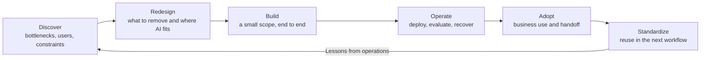
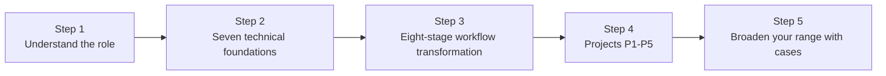

  

# AX Engineer Roadmap

[한국어](../README.md) · [English](README.md)

An **AX Engineer** identifies work AI can help with, integrates it with existing systems, and takes responsibility for implementation, evaluation, and operations. Together with the process owner, the engineer decides what can be automated and where human judgment must remain.

This repository is a roadmap for juniors and career changers preparing for AX engineering. It guides you step by step to **understand the role, develop the required skills, and complete a project that changes real work**. AX here means AI Transformation; titles and responsibilities vary across organizations.

> [!TIP]
> New here? Pick the route closest to your experience in [Find your starting point](#find-your-starting-point). To see the whole picture first, go to [Roadmap at a glance](#roadmap-at-a-glance).

## Contents

- [What does an AX Engineer do?](#what-does-an-ax-engineer-do)
- [Find your starting point](#find-your-starting-point)
- [Roadmap at a glance](#roadmap-at-a-glance)
  - [Step 1. Understand the role](#step-1-understand-the-role)
  - [Step 2. Learn the technical foundations](#step-2-learn-the-technical-foundations)
  - [Step 3. Learn the sequence for changing a workflow](#step-3-learn-the-sequence-for-changing-a-workflow)
  - [Step 4. Build artifacts through projects](#step-4-build-artifacts-through-projects)
  - [Step 5. Broaden your range with cases](#step-5-broaden-your-range-with-cases)
- [Working templates](#working-templates)
- [Frequently asked questions](#frequently-asked-questions)
- [Source principles and participation](#source-principles-and-participation)

## What does an AX Engineer do?

The work does not end when a prototype runs. A workflow transition is complete only when the people who will check outcomes and run operations are named and can safely take over.

| What the role does | What it does not decide alone |
|---|---|
| Finds workflow bottlenecks and sets technical scope | Company-wide AI strategy and outcome targets |
| Connects data and systems, then builds and deploys directly | Source-of-truth definitions in place of data owners |
| Builds evaluation, security, observability, and recovery | Risk exceptions in place of security and legal owners |
| Designs business adoption and operational handoff | Permanently taking over users' manual work |

[Read the role model](roadmap/role-model.md) · [Roles observed in job material](research/ax-engineer-role-review.md) · [Job-posting records](research/hiring-signals.md)

## Find your starting point

Every route begins with P1. Prior experience does not waive the exit criteria for any stage.

| Where I am now | Read first | Example first artifact |
|---|---|---|
| Little or no development experience | [Entry route 1](learning-paths/entry-routes.md#1-little-or-no-development-experience) → [P1](projects/01-safe-assistant.md) | An assistant that answers from a public manual with sources, or declines to answer |
| Web, backend, or data development experience | [Entry route 2](learning-paths/entry-routes.md#2-existing-developers-moving-into-ax-work) → [AX Engineer path](tracks/ax-builder.md) | A synthetic request-classification service with evaluation records |
| Strong domain knowledge, limited development experience | [Entry route 3](learning-paths/entry-routes.md#3-people-with-domain-expertise) → [Business practitioner guide](tracks/business-practitioner.md) | A review table of missing evidence for synthetic expense requests |
| Terms such as API, RAG, and MCP are unfamiliar | [Non-developer glossary](start-here/non-developer-glossary.md) | Understanding what API, RAG, and MCP look like in daily work |
| I want to run code first | [Synthetic VOC runbook](case-studies/beauty-d2c-voc/RUNBOOK.md) | Reproduce the published result (no external account or API needed) |

If you are unsure which decisions you will actually own, regardless of title, start with the [persona selector](start-here/persona-selector.md).

## Roadmap at a glance

Each step lists documents to read and items to check yourself. The checks are questions to answer before moving on; they do not certify proficiency.

### Step 1. Understand the role

Learn the responsibilities of an AX Engineer and how role scope differs between companies. Job material is a dated research record, so check the original posting for current availability.

| Document | What you get |
|---|---|
| [Role model](roadmap/role-model.md) | Scope of responsibility, three operating models, and role boundaries |
| [Public role review](research/ax-engineer-role-review.md) | How postings divide discovery, implementation, operations, and business support |
| [Competency framework](roadmap/competency-map.md) | Eight areas: business value, workflow, data, integration, AI, operations, adoption, organizational learning |
| [Proficiency criteria](roadmap/proficiency-levels.md) | How Foundation → Builder → Operator → Lead are judged |

- [ ] I can explain what an AX Engineer does and what the role does not decide alone.
- [ ] I can take one posting and say whether it leans toward discovery, implementation, operations, or support.

### Step 2. Learn the technical foundations

Rather than memorizing product names, build the judgment to decide **when to choose an approach and what to test**. If a simpler approach meets the success criteria, keep it.

| Area | Key question |
|---|---|
| [Software and APIs](technical-foundations/software-and-api.md) | Can existing systems be connected without losing state, permissions, and failure handling? |
| [LLM foundations](technical-foundations/llm-foundations.md) | Can model nondeterminism, context, cost, and limits be translated into workflow conditions? |
| [Agent systems](technical-foundations/agent-systems.md) | Can you justify iterative reasoning and define stop and memory boundaries? |
| [Tool calling and MCP](technical-foundations/tools-and-mcp.md) | Can validation, policy, permission, and approval sit between model output and action? |
| [Evaluation and testing](technical-foundations/evaluation-and-testing.md) | Can normal, edge, and failure cases judge changes consistently? |
| [Production operations](technical-foundations/production-operations.md) | Can quality, cost, latency, and failure be detected, stopped, and recovered? |
| [Security and privacy](technical-foundations/security-and-privacy.md) | Can data and action authority be controlled across the lifecycle? |

- [ ] I can justify choosing among rules, search and classification, drafting, execution after approval, or an agent.
- [ ] I can build an evaluation set from normal, edge, and failure inputs and rerun the same evaluation.

[All seven technical foundations](technical-foundations/README.md)

### Step 3. Learn the sequence for changing a workflow

Work through eight stages, from choosing a workflow to operating and reusing it. When operations reveal a new constraint, return to an earlier stage.

1. [Goals and boundaries](delivery-lifecycle/01-outcomes-and-boundaries.md)
2. [Understand the current workflow](delivery-lifecycle/02-workflow-discovery.md)
3. [Redesign the workflow](delivery-lifecycle/03-process-redesign.md)
4. [Data and context](delivery-lifecycle/04-data-and-context.md)
5. [Execution rules and controls](delivery-lifecycle/05-execution-contracts.md)
6. [Production deployment](delivery-lifecycle/06-production-deployment.md)
7. [Workflow transition and role change](delivery-lifecycle/07-adoption-and-change.md)
8. [Standardization and scale](delivery-lifecycle/08-standardization-and-scale.md)

- [ ] I can map the current flow, waits, exceptions, and handoffs of the workflow I chose.
- [ ] I can separate steps to remove, steps people judge, and steps where AI helps.

[Eight-stage overview](delivery-lifecycle/README.md) · [Organization readiness](start-here/organization-readiness.md) · [Korean organizational conditions](research/roadmap-benchmark-review.md)

### Step 4. Build artifacts through projects

Expand scope in order, starting from P1. Use the organization track when you have access, or the public-simulation track when you do not. The goal is to retain **evaluation, approval, failure, and recovery records**, not only code.

| Practice | Target artifact | Evidence needed before the next stage |
|---|---|---|
| [P1 · Safe assistant](projects/01-safe-assistant.md) | Assistance with sources, refusal conditions, and evaluation | Normal, edge, and failure evaluation with independent review; no external actions |
| [P2 · Accountable approval](projects/02-human-approved-workflow.md) | Simulated execution recording approval, rejection, and cancellation | Approval target and version, approver authority, blocked approval bypass |
| [P3 · Sandbox integration](projects/03-sandbox-integration.md) | Isolated integration with duplicate and failure-test records | Duplicate and partial-success handling; executed stop, recovery, and manual-fallback records |
| [P4 · Operating pilot](projects/04-production-pilot.md) | Acceptance and recovery records from limited operations or an executed simulation | Operational, cost, and workflow measures; incident response and handoff |
| [P5 · Reuse in a second workflow](projects/05-second-workflow-reuse.md) | What was reused and decisions to retain, revise, or retire it | Results of reuse in a second workflow |

These are learning targets. Do not present simulations as organizational operating experience.

[Practice and exit criteria](projects/README.md) · [12-week practice path](learning-paths/12-week-practice.md)

### Step 5. Broaden your range with cases

Compare systems of record, approval points, and failure handling across 15 workflow cases, including VOC analysis, meeting follow-ups, employee access, card expenses, and inventory exceptions. Use them to choose a first task or find conditions that differ from your own workflow.

Runnable example: **1** · Design documents: **14** · [Workflow cases and implementation scope](case-studies/README.md)

The runnable example uses synthetic data and rule-based code to implement partial P1 functionality. Its implemented scope and what remains unproven are described in the [example overview](case-studies/beauty-d2c-voc/README.md#current-execution-evidence). The separate [catalog of 40 Korean and international public cases](research/public-ax-cases.md) examines workflows and reported outcomes from outside organizations, with evidence and limitations.

One runnable example: why a classification can still need more information

> “The pump will not press, so I cannot get the contents out.”

This is a translation of synthetic VOC `voc-006`. It is classified as a packaging issue (`packaging`), but the missing product ID flags it for further review (`review_required`). Explaining what was classified and what information is still needed is part of AX engineering.

Write one line for why this inquiry needs further review and one for what the reviewer should confirm. You can reproduce it yourself with the [runbook](case-studies/beauty-d2c-voc/RUNBOOK.md).

## Working templates

These forms capture decisions, responsibilities, and verification results that are easy to miss when changing a workflow. Trim them to the workflow's risk and size.

| When to use | Template |
|---|---|
| Finding candidate workflows | [Workflow discovery card](toolkit/workflow-discovery-card.md) · [Use-case scorecard](toolkit/use-case-scorecard.md) |
| Agreeing on goals, permissions, approvals, and stop criteria | [Workflow execution rules](toolkit/execution-contract.md) |
| Testing small and recording results | [Experiment card](toolkit/experiment-card.md) · [Evidence ledger](toolkit/evidence-ledger.md) |
| Writing up results as a case | [Case-study template](toolkit/case-study-template.md) |
| Reusing work in a second workflow | [Reusable skill card](toolkit/reusable-skill-card.md) · [UI integration checklist](toolkit/ui-integration-checklist.md) |

How to share responsibilities with business, leadership, data, security, and operations partners is covered in [Collaboration roles](tracks/README.md).

## Frequently asked questions

Can I become an AX Engineer without a development background?

Domain experts can first join as collaborators who own workflow criteria and acceptance review. To move into engineering, prepare separately for running code, fixing errors, and reproducing tests, then start by implementing P1. The [entry routes](learning-paths/entry-routes.md#3-people-with-domain-expertise) compare both options.

Can I practice without company data or operational access?

Yes. The first P1 exercise uses only public or synthetic data and does not change external business systems. Without organizational conditions, P4 can also run as a public simulation. Do not present simulation results as real user adoption or organizational outcomes.

How long does it take? Will it get me a job?

The [12-week practice path](learning-paths/12-week-practice.md) is an example schedule for organizing assignments. It does not guarantee proficiency by a certain time or employment. Proficiency is judged by responsibilities taken on and results verified, not by time spent or number of tools.

Can I use AI coding tools?

Yes. You still need to explain the inputs, outputs, and reasons for failure yourself, and be able to rerun the same evaluation.

If I practice alone, who decides whether I pass?

A reviewer who did not take part in implementation should check the results with new inputs. If you cannot find a reviewer, keep only your self-check results and hold the pass decision.

## Source principles and participation

Runnable examples, design targets, and outside organizations' reports are distinguished. Source verification dates and limitations are recorded in the [research documents](research/README.md), and changes appear in the [changelog](CHANGELOG.md). If you find something missing or wrong, let us know through an issue or pull request.

[Contribute](CONTRIBUTING.md) · [Questions and support](SUPPORT.md) · [Source policy](research/source-policy.md) · [Governance](GOVERNANCE.md) · [Security](SECURITY.md) · [Code of conduct](CODE_OF_CONDUCT.md)

Next release candidate: `v0.4.0` · Recorded published release: `v0.3.0` · [MIT License](../LICENSE)
