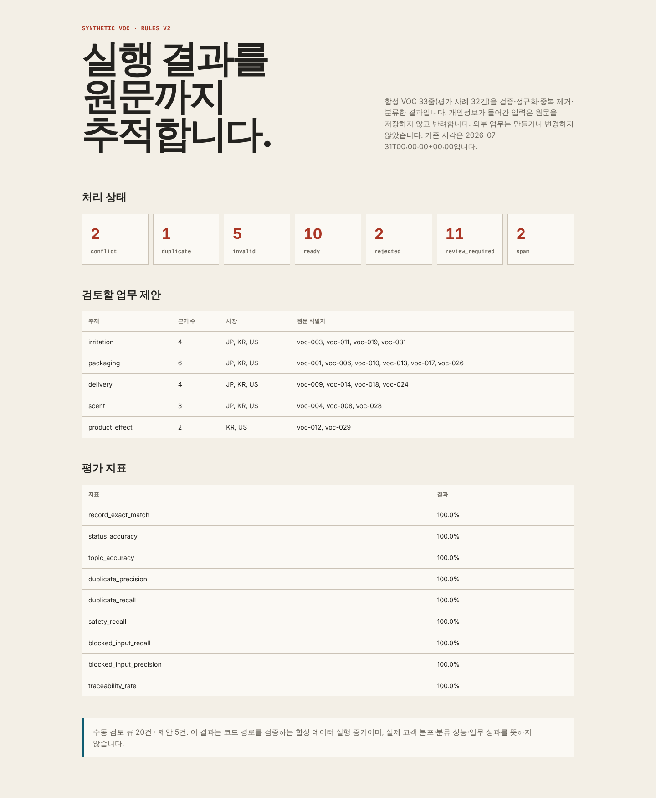

# Case: From Global Beauty/D2C VOC to an Action Proposal

<!-- case-boundary:start -->
## Current scope and designed target

| Scope | Write impact | Autonomy | Related P stages |
|---|---|---|---|
| Current public artifact | No external write | A1-A2 | P1 |
| Designed target | Approved sandbox write | A1-A3 | P1, P2, P3, P5 |

Current values cover only what this repository can reproduce. A current P label identifies a stage with implemented functionality, not completion of all its exit criteria. The designed target is not yet an implemented scope or evidence of organizational outcomes.
<!-- case-boundary:end -->

> Public-case use: The [public case-to-practice table](../../research/public-case-application-map.md) applies K04's agent review to the manual review queue and owner approval. G07's editorial approval and edit-rate measures inform proposal approval and reviewer-effort evaluation.

## Case type

This is not an internal diagnosis or consulting outcome for a specific company. Public cases contribute evaluation questions only; the executable input is a synthetic fixture built around common Beauty/D2C workflow patterns.

## Current execution evidence

This case now includes a reproducible pipeline that processes 16 synthetic VOC records with the Python standard library and no external API or model call. The dataset deliberately includes duplicates, missing required fields, spam, mixed language, stale records, and safety signals.



The current run produced 5 ready records, 7 manual-review records, 2 invalid records, 1 duplicate, and 1 spam record. It generated four proposal artifacts with source identifiers and no external write. All 16 expected status, topic, and safety outcomes matched, with nonempty `evidence_ref` values on 100% of processed records (16/16).

[Runbook](RUNBOOK.md) · [Evaluation report](../../../case-studies/beauty-d2c-voc/artifacts/evaluation-report.md) · [Dashboard HTML](../../../case-studies/beauty-d2c-voc/artifacts/dashboard.html) · [Run manifest](../../../case-studies/beauty-d2c-voc/artifacts/run-manifest.json)

These numbers verify the code path on a synthetic evaluation set. They do not measure real VOC distribution, production classification quality, workflow adoption, or business outcomes. `traceability_rate` measures nonempty `evidence_ref` presence; it does not test source-link reachability or evidence correctness.

The demonstrated boundary is `current_autonomy=A1-A2`, `current_write_impact=none`, and `implemented_project_stages=[1]`. `[1]` identifies some P1 functionality, not a complete stage pass. Reproducing the 16-record set does not establish P1's minimum 20 evaluation cases and independent review on new inputs. Preserve this set and add separate evaluation. A3 sandbox writes and P2, P3, and P5 remain unimplemented design targets.

## Problem hypothesis

Global consumer reviews and inquiries are distributed across countries, languages, and channels. Marketing, product, customer-support, and operations teams repeat similar research, but different provenance, periods, samples, and classification rules make the output difficult for another team to reuse.

Initial hypothesis:

> Preserving original text and collection scope, detecting recurring issues and opportunities, and requiring a person to verify evidence before approving an action proposal can make research and handoff more consistent.

This hypothesis does not imply improvements in time, quality, or revenue for a real company. The system's quality and operability must first be tested with public data, then re-evaluated in an environment with real business baselines.

## Users

| User | Needed outcome | Responsibility |
|---|---|---|
| VOC analyst | Recurring issues and original evidence | Review collection scope and classification |
| Marketing and product | Actionable opportunities and impact scope | Set workflow priority |
| Customer support and operations | Complaints and exception flows | Confirm response and operating impact |
| Process owner | Approvable proposal with cost and risk | Decide execution or stop |

## Designed end-to-end flow

```text
Load the synthetic VOC fixture
→ Preserve original text, provenance, time, and channel
→ Normalize language, product, and topic
→ Detect recurring issues and opportunities
→ Practitioner verifies evidence
→ Generate an action proposal
→ Human approval
→ Record execution status and outcomes
```

The current code validates and classifies synthetic inputs and generates review queues and proposals. It does not implement the practitioner evidence check or approval shown above and creates no internal task. `requires_human_approval=true` and `action_boundary=proposal_only` describe the proposal boundary; they are not records of actual approval or review.

## Initially out of scope

- Customer data that can identify an individual
- Automatic changes to pricing, discounts, inventory, or purchase orders
- Automatic publication of efficacy or regulatory claims
- Automatic external messages sent through customer accounts
- Estimating real revenue impact from public data alone

## Draft data contract

| Field | Meaning | Required | Quality check |
|---|---|---:|---|
| `source_id` | Original review or inquiry identifier | Yes | Duplicate check |
| `source_type` | Input provenance | Yes | Current code accepts only `synthetic` |
| `source_url` | Source location or synthetic fixture URL | Yes | Current code checks only the `https://` prefix |
| `captured_at` | Collection time | Yes | Time zone |
| `published_at` | Original publication time | Optional | Missingness distinguished |
| `market` | Country or market | Yes | Standardized code |
| `channel` | Review or inquiry channel | Yes | Allowed values |
| `product_id` | Product identifier | Optional | Mapping evidence |
| `language` | Original language | Yes | Allowed-code check; automatic language detection is not implemented |
| `text_original` | Original text | Yes | Empty or truncated values |
| `text_normalized` | Normalized analysis text | Optional | Transformation version |
| `topic` | Topic classification | Optional | Model and rule version |
| `evidence_ref` | Link between proposal and source | Created in output | Reverse traceability |

The machine-readable contract is [`voc-record.schema.json`](../../../case-studies/beauty-d2c-voc/schemas/voc-record.schema.json), and the executable fixture is [`voc-sample.jsonl`](../../../case-studies/beauty-d2c-voc/data/input/voc-sample.jsonl). No public-site collection adapter is included. Before adding one, verify the source's terms, license, privacy conditions, and collection scope.

## Pipeline

Run from the repository root:

```bash
python3 case-studies/beauty-d2c-voc/pipeline/run_pipeline.py
```

The deterministic baseline validates input, normalizes text while preserving the original, marks duplicates, classifies a declared keyword set, sends missing, mixed-language, stale, unclassified, and safety cases to review, then creates only source-linked proposals. It is a reproducible control-flow baseline, not a production multilingual model.

## Draft workflow execution rules

### Input

- Current implementation: synthetic VOC that passes the contract. Real public VOC is an extension requiring separate collection and review
- Analysis period, market, channel, and product scope
- Topic, severity, and opportunity criteria

### Output

- Issue or opportunity title
- Original evidence and provenance
- Observed frequency and scope
- Sample, missingness, and language limitations
- Proposed action and candidate owner
- Approved, held, or rejected state

### Autonomy

- Current fixture loading, normalization, and classification: A1–A2
- Current issue and opportunity proposals: A2
- Designed next step for approved internal task creation: A3
- External publishing and price or inventory changes: outside initial scope

## Evaluation

Do not judge quality from normal cases alone.

- Duplicate reviews with the same content
- Deleted or inaccessible source text
- Mixed-language cases
- Missing or incorrectly linked product names
- High-frequency but low-impact issues
- Low-frequency but high safety or regulatory risk
- Promotional, irrelevant, or spam content
- Old data that appears to be a recent issue

Evaluation dimensions:

- Traceability to original text
- Classification accuracy and unclassified-case handling
- Rate of unsupported claims
- Types of practitioner corrections
- Processing time and rework
- Reasons for approval, hold, and rejection

The expected outcomes are fixed in [`expected.jsonl`](../../../case-studies/beauty-d2c-voc/data/evaluation/expected.jsonl). Run the regression suite with:

```bash
python3 -m unittest discover \
  -s case-studies/beauty-d2c-voc/tests \
  -p 'test_*.py' \
  -v
```

## Four-week next-stage validation plan

### Week 1

- Finalize public-data scope and collection limits.
- Document the current analysis flow and baseline.
- Prepare the data contract and evaluation cases.

### Week 2

- Implement classification and summary with source traceability.
- Create a practitioner-review interface or output contract.
- Evaluate errors, missingness, and duplicates.

### Week 3

- Connect approved proposals to internal task creation.
- Implement permissions, deduplication, audit records, and recovery.
- Inspect operating status and cost.

### Week 4

- Run user acceptance with an external reviewer or operator.
- Record correction burden, trust, and workflow completion.
- Decide which contracts to reuse and which abstractions to discard.

## Exit criteria for the next extension

These criteria apply when extending the exercise to P2 and P3. The published code implements some rule-based P1 functionality; model calls, approval, and writes to a workflow system are not implemented.

1. Preserve the 16 synthetic records and their expected results. Evaluate any added model in a separate run against the rule-based baseline, recording model, API, SDK, prompt, and evaluation-set versions. These 16 records alone do not establish generalization quality.
2. Restore initial state between repeated quality trials and compare topics, safety signals, source links, and review time on the same inputs. Record retained state and starting conditions separately for duplicate and reconnection tests. Do not supply evaluation answers to the model or change the baseline answers to match its output.
3. Block execution if a proposal changes while awaiting approval or the approver's authority is revoked. Record the approved version and execution identifier.
4. Disconnect immediately after saving in a test task system, then reconnect. Check whether the same task already exists before retrying. Evaluate the proposal's completion message separately from the saved system state.
5. Calculate [cost per completed workflow](../../toolkit/experiment-card.md), including failures, retries, review, and rework. If there are no completions, leave unit cost unavailable and record failure costs and the reason to hold.

Use the [K04 follow-up evidence](../../research/public-ax-cases.md) to decide what work reviewers will take on when repetitive checking decreases. Record review time, correction reasons, holds, rejections, and handoffs in this exercise. Do not transfer the external contact center's outcome figures into an expected benefit for this VOC exercise.

## Published artifacts

- [Synthetic input and collection boundary](../../../case-studies/beauty-d2c-voc/data/input/voc-sample.jsonl)
- [Data schema](../../../case-studies/beauty-d2c-voc/schemas/voc-record.schema.json)
- [Normalization and classification code](../../../case-studies/beauty-d2c-voc/pipeline/run_pipeline.py)
- [Classified records](../../../case-studies/beauty-d2c-voc/artifacts/classified-records.jsonl)
- [Manual review queue](../../../case-studies/beauty-d2c-voc/artifacts/review-queue.json)
- [Source-linked workflow proposals](../../../case-studies/beauty-d2c-voc/artifacts/workflow-proposals.json)
- [Evaluation report](../../../case-studies/beauty-d2c-voc/artifacts/evaluation-report.md)
- [Run and recovery instructions](RUNBOOK.md)
- [Result dashboard](../../../case-studies/beauty-d2c-voc/artifacts/dashboard.html)
- [Hashes separating generated outputs from the manual preview asset](../../../case-studies/beauty-d2c-voc/artifacts/run-manifest.json)

## Results and limitations

The current evidence shows that the same code can replay the synthetic fixture, separate failures, duplicates, and missing data, and trace each proposal to its source identifier. It does not verify public-site collection, a multilingual model, accountable approval, task-system integration, long-running operations, or user acceptance. It therefore supports no claim about real complaint mix, generalization quality, time saved, product improvement, or revenue effect.

## Open questions

- How well does public data represent internal VOC?
- How should collection bias by language and market be expressed?
- What evidence shows that a proposal reached actual work?
- Who owns the final definition when departments interpret the same issue differently?
- Which contracts and components can be reused in a second workflow?
