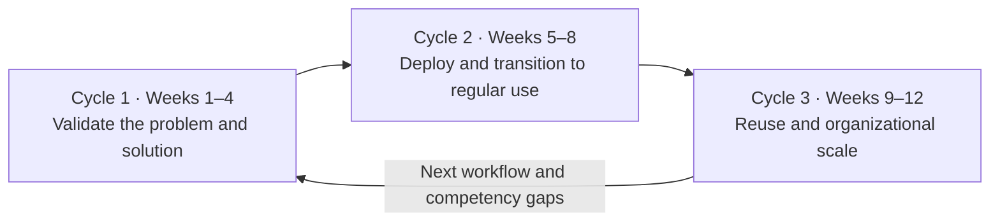

# AX Engineer 12-Week Practice Path

## Goal

Instead of reading technologies in sequence, spend twelve weeks discovering and implementing one workflow, then reuse what proved valuable in a second workflow. The organization track covers production operations, transition into regular use, and handoff. The public simulation track practices deployment and recovery in a validation environment. Every week should preserve not only outputs, but the reasoning and verifiable evidence behind them.

## Principles before starting

- In both tracks, weeks 1–4/P1 use only public or synthetic data and make no external business-system changes. Later organizational-data use requires the stage-specific permitted scope and approval.
- Distinguish P1 model-processing requests from customer-facing sends, publication, and business-system writes. Compare rules and LLMs only using an authorized local model or a model API that meets [P1's authority, data, and cost conditions](../projects/01-safe-assistant.md).
- Define the measurement method and baseline before creating impact claims.
- Add actions that change external systems only after human approval and recovery paths are ready.
- Every week, decide `continue / revise / hold / stop` and record the evidence.
- Preserve workflow identifiers, evaluation, approvals, and records even when changing tools or models.
- Confirm the AX Engineer responsibilities and collaboration roles in the [Role Guide](../start-here/persona-selector.md).
- Use [Organization Readiness](../start-here/organization-readiness.md) to bound the action scope.

## Choose a practice setting

Choose a setting according to your access to organizational systems and users. The deliverables may look similar, but they support different claims.

| Area | Organization track | Public simulation track |
|---|---|---|
| Data | Public or synthetic data for P1; later, non-sensitive or masked data approved for the relevant stage | Public or synthetic data |
| Systems | Real development, test, and production environments | Sandboxes, test doubles, and personal environments |
| Users | Real workflow users and operators | Independent reviewers and simulated roles |
| What it can verify | Production deployment, actual use, handoff, and procedure change | Design, implementation, evaluation, recovery practice, and usability feedback |
| What it cannot claim | Unmeasured organizational impact | Real production use, official procedure change, or organizational impact |

A public simulation can show technical skill and judgment. By itself, it does not prove production responsibility at the Builder or Operator level. Mark the case title and outcomes as a `simulation`.

The five [practice projects](../projects/README.md) provide checkpoints for this 12-week path. Weeks 1–4 produce the safe assistant, weeks 5–6 add approval and sandbox integration, weeks 7–8 run a pilot or simulation, and weeks 9–12 test reuse in a second workflow.

Calendar progress does not pass a gate. After P1–P3, check the organizational or simulation requirements of [P4](../projects/04-production-pilot.md). Even simulation requires executed failure/recovery tests and independent review before P5 execution verification. If missing environments or reviewers limit the work to documentation, record that scope only.

## Entry point and optional exercises

Use [entry routes by prior experience](entry-routes.md) to identify demonstrated skills and gaps to practice first. Prior experience does not waive approval, authority, evaluation, or recovery gates without evidence. If prerequisites or a test environment are missing, meet the gate before advancing by calendar week.

| Timing | When to choose it | Resource |
|---|---|---|
| Weeks 5-6, P3 | An official API or another supported integration cannot perform the needed task, so bounded UI interaction is being considered | [UI integration checklist](../toolkit/ui-integration-checklist.md). Retain the manual procedure if execution, approval, target confirmation, or failure tests do not pass |
| Weeks 9-12, P5 | Repeated procedures and reference material justify packaging a skill for a different workflow | [Reusable skill card](../toolkit/reusable-skill-card.md). Compare against a no-skill baseline and applicable and inapplicable requests; decide to reuse, revise, or retire |

Use an existing authorized test system for UI practice. Without that environment, report only design and simulated-review scope. Continue with supported approaches instead of waiting for proposals; record proposal status separately in the [review list](../research/standards-watchlist.md).

## Cycle 1. Validate the problem and solution

### Week 1: Select a workflow and establish a baseline

- Distinguish users, process owners, and people who may be harmed.
- Compare three workflow candidates by value, frequency, evidence, data, risk, and recoverability.
- Look up why similar work stopped in the [public failure and stop cases](../research/ax-failure-cases.md) and answer the [capstone design checklist](../research/ax-failure-cases.md#checklist-for-capstone-design).
- Record the current flow, bottlenecks, waiting, and exceptions.
- Define success and stop conditions plus initial non-goals.

Evidence:

- [Workflow discovery card](../toolkit/workflow-discovery-card.md)
- [Use-case scorecard](../toolkit/use-case-scorecard.md)
- Current workflow
- Baseline and outcome contract

### Week 2: Redesign the process and define the data contract

- Reclassify current steps as remove, combine, standardize, AI assist, human approval, or automatic execution.
- Identify systems of record and data owners.
- Define rules for inputs, outputs, workflow terminology, missingness, and conflicts.
- Draw the target flow and manual fallback.

Evidence:

- Current-to-target workflow comparison
- Responsibility matrix
- Data and schema contract
- Glossary and manual fallback

### Week 3: Build a trustworthy assistive feature

- Implement only the necessary level of search, classification, summary, or proposal.
- Make source text, provenance, and version traceable from every result.
- Let a person revise, hold, or reject results and record the reason.
- Do not add capabilities unrelated to the workflow.

Evidence:

- A prototype that implements the core flow from start to finish
- Executable code and tests
- Input and output examples
- Decision and correction records

### Week 4: Evaluate and make the first gate decision

- Execute at least 20 evaluation cases covering normal, edge, and failure conditions under [P1](../projects/01-safe-assistant.md), with independent review on inputs not used in development.
- Measure quality, groundedness, safety, latency, and cost where relevant.
- Reproduce invalid data, model failures, and permission errors.
- Verify P1 passing evidence and decide whether to proceed to P2 approval practice, revise, hold, or stop. This decision is not production-deployment approval.

Evidence:

- Evaluation data and adjudication criteria
- Evaluation results and failure taxonomy
- Model, prompt, and tool versions
- [Experiment card](../toolkit/experiment-card.md)

## Cycle 2. Production deployment and workflow transition

### Week 5: Define workflow execution rules and integration

- Separate what AI may read, propose, and execute.
- Define human approval points and criteria by role.
- Design APIs, events, identifiers, and failure boundaries for the systems to integrate.
- Define stop conditions for data exposure, invalid actions, duplicate execution, and excessive cost.

Evidence:

- [Workflow execution rules](../toolkit/execution-contract.md)
- Permission and approval matrix
- API, event, and identifier contracts
- Threat model and integration design

### Week 6: Implement integration and controls

- Integrate at least two isolated test systems or sandbox adapters. Record P2 approval decisions as simulated actions and test authorized writes in P3.
- Implement authentication, authorization, secrets, deduplication, retries, and state persistence.
- Record execution, approval, outcomes, and failures under the same identifier.
- Separate development, test, and production for the organization track; separate local and test for the public simulation.
- Have another developer reproduce the core flow in a test environment.

Evidence:

- Executable code and integration tests
- Deployment and environment configuration
- Audit and change records
- Developer handoff

### Week 7: Deploy, observe, and recover

- In the organization track, deploy to production for a bounded group and scope.
- In the public simulation, deploy to a validation environment isolated from production.
- In both tracks, observe quality, latency, cost, and error states.
- Record actual use in the organization track and independent-review usability problems in the simulation.
- Inject outages, stale data, invalid results, and permission errors in an isolated validation environment. Production stop/recovery exercises require separately authorized scope.
- Exercise stop, rollback, and manual fallback.

Evidence:

- Operating status report or dashboard
- Alerts and runbook
- Incident and recovery exercise
- Cost, quality, and reliability review

### Week 8: User acceptance and workflow transition

- In the organization track, have an operator other than the implementer handle representative and exception flows.
- In the public simulation, have an independent reviewer reproduce the same flow using only the documentation.
- Observe correction burden, repeat use, support requests, and workflow outcomes or usability problems.
- In the organization track, hand off training, support, inquiry channels, and operating responsibility, then decide the old process's state.
- In the public simulation, document review limits without claiming production use or procedure change.

Evidence:

- User acceptance or independent-review record
- Training and support documentation
- Adoption and workflow-outcome review, or simulation limitations
- Old-process retirement or retention decision, or simulated transition conditions

## Cycle 3. Reuse and organizational scale

### Week 9: Select a second workflow and define its contract

- Select a workflow similar to the first but different in user, data, or risk.
- Classify existing contracts and components as reusable unchanged, configurable, or newly implemented.
- Adapt target flow, data contract, execution scope, and evaluation criteria to the second workflow.
- Separate technical barriers to reuse from genuine workflow differences.
- Do not force the first case's structure as the answer.

Evidence:

- Second workflow discovery card
- Cross-case difference table
- Reuse hypothesis
- New scope and stop conditions

### Week 10: Redeploy for the second workflow

- Use contracts, code, and templates from the first workflow to implement the second thin vertical slice.
- Separate unchanged reuse from configuration and code changes.
- Implement authentication, approval, and recovery for the second workflow, and record each run under the same identifier.
- Remove or reverse abstractions for the first workflow if they obstruct the second.

Evidence:

- Executable code for the second workflow
- Reuse, configuration, and new-implementation list
- Integration and regression tests
- Change-decision record

### Week 11: Evaluate reuse and acceptance

- Run normal, edge, and failure evaluation plus recovery exercises for the second workflow.
- Have real users and operators review in the organization track, or independent reviewers in the public simulation.
- Compare time, change scope, and operating burden with the first workflow.
- Separate reused parts, failed abstractions, and parts demonstrated in only one case.
- Decide to standardize, retain, revise, or retire each part based on evidence.

Evidence:

- Evaluation and recovery records for the second workflow
- User acceptance or independent-review record
- Cross-case reuse comparison
- Standardize, retain, revise, or retire decision

### Week 12: Standardize and complete the case

- Extract only contracts validated across both workflows—input, output, evaluation, approval, records, and recovery—into the shared harness.
- Define versioning, compatibility, extension points, retirement policy, and the boundary of team autonomy.
- In the organization track, document responsibilities across the central AX team, business, IT, data, and security, plus current maturity.
- In the public simulation, distinguish assumptions about the target organization and permissions from verified facts.
- Present problem, choices, implementation, failures, operations, regular use and handoff, and reuse as one case.
- Put outcomes, limitations, and claims not made in the same document.
- Use the [competency framework](../roadmap/competency-map.md) and [proficiency levels](../roadmap/proficiency-levels.md) to identify remaining gaps.

Evidence:

- Shared contracts and extension points
- Version and compatibility policy
- Organizational responsibility and maturity diagnosis, or simulation assumptions
- [Case-study document](../toolkit/case-study-template.md)
- [Evidence ledger](../toolkit/evidence-ledger.md)
- Learning and execution plan for the next twelve weeks

## Assessment and reassessment by stage

At weeks 4, 8, and 12, evaluate a new scenario not used during development. A reviewer outside the implementation work prepares inputs and the rubric; the implementer freezes versions before the assessment. Review handling after holds, refusals, and failures as well as successful output.

| Timing | Scope to verify | Records |
|---|---|---|
| Week 4 | Provenance, quality, and refusal on unseen inputs, compared with the rules-based approach | Rubric, first-run results, and failure causes |
| Weeks 5–6 | Approval waits, permission revocation, duplicates, and partial success in [P2](../projects/02-human-approved-workflow.md) and [P3](../projects/03-sandbox-integration.md) | Approved version, execution state, and external-result reconciliation |
| Weeks 7–8 | Reconnection, actual cancellation, policy service outages, regression and rollback, and total cost per completed workflow in [P4](../projects/04-production-pilot.md) | Review by role, stop and recovery results, cost calculation, and omitted costs |
| Week 12 | New exceptions in the second workflow and the effect of shared-rule changes on the first | Regression results for both workflows, reuse decisions, and operating handoff |

Managers assess value and acceptable risk; actual users assess quality and correction burden; operators assess incident response and handoff. In a public simulation, disclose the roles played by reviewers and organizational conditions left unverified. If no independent reviewer is available, retain self-check results and leave completion pending.

Preserve the first assessment before repair. After changes, rerun previous failures and regression evaluations, and add unseen scenarios of the same failure type. Do not count features without a passing record or untested operating conditions as completed scope.

### Educational reference and scope

Anthropic announced [Claude Frontier Academy](https://www.anthropic.com/news/claude-frontier-academy) on 2026-10-02. Its program uses simulated enterprise deployment, a graded practical on a new scenario, and a 12-week organizational Claude residency with reassessment. The first final credentials are expected in early 2027. This roadmap draws on new-scenario assessment and reassessment. Review by someone other than the implementer is this repository's separate requirement, not a claim about the Academy's assessors. The roadmap does not confer its credentials or claim graduate outcomes. Verified: 2026-10-26.

## Questions to repeat every week

- What new fact was verified this week?
- Which hypothesis was wrong?
- What is the largest risk or operating burden?
- Did user behavior actually change?
- What should be retained or discarded next week?
- If the project stops now, is there still explainable evidence?

## Completion criteria

- Within the selected practice setting, one workflow has progressed from discovery and implementation through deployment and acceptance.
- Normal, edge, and failure evaluation plus recovery records exist.
- Someone other than the implementer has directly tested the core flow and representative exceptions.
- Reused parts and failed abstractions from the second workflow can be explained.
- The boundary between shared organizational criteria and team autonomy is documented.
- Outcomes and limitations are visible in the same case.

Additional completion criteria for the organization track:

- Real operating scope, actual use, handoff, and the old process's state are verified.

Additional completion criteria for the public simulation track:

- Sandbox or test environment and independent-review scope are disclosed.
- No claims are made about production use, official procedure change, or organizational impact.
