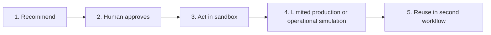

# Practice Projects for AX Engineers

Complete these five projects in sequence, checking the authority and deployment, recovery, and handoff responsibilities required at each stage. Passing a practice does not grant execution authority; approval remains specific to the environment and target. Do not broaden live-system permissions or automatic action without evidence that the previous gate was met.

## Project sequence

| Stage | Project | Action scope | Result to verify |
|---|---|---|---|
| 1 | [Safe Assistant](01-safe-assistant.md) | Public or synthetic data, no external action | Eval set, provenance, refusal |
| 2 | [Human-Approved Workflow](02-human-approved-workflow.md) | Record only approved proposed actions | Approval criteria, before and after, audit |
| 3 | [Sandbox Integration](03-sandbox-integration.md) | Read and write in test systems | Permission separation, deduplication, recovery |
| 4 | [Production Pilot](04-production-pilot.md) | Bounded production or isolated operational simulation | SLO, actual versus simulated use, incidents, handoff |
| 5 | [Second-Workflow Reuse](05-second-workflow-reuse.md) | Reuse of validated rules and components | Reuse comparison, versioning, and standardization decision |

## Two ways to complete the projects

### Organization track

Actual workflow owners and users participate, using organizational test and production environments and approval processes. P1 still uses only public or synthetic data and makes no external changes. Later use of organizational data follows current policy and owner approval; P3 uses test environments, while the organizational P4 uses an authorized production environment.

### Public simulation track

Use public or synthetic data and an isolated environment. Publish assumptions, test scope, and unverified areas. Do not claim real production use, organizational impact, or official process change.

Without a development environment, practice the same decisions using documents, tables, no-code sandboxes, or role-play. Distinguish document review from executed tests and state when no external action occurred. Documents alone do not pass P3 or the P4 simulation without execution and recovery tests.

After verifying P1–P3 evidence, choose the organization or public-simulation setting for P4. Simulation still requires executed failure, stop, and recovery tests and independent review. Following the [P4 decision for that setting](04-production-pilot.md), proceed to P5 within the same evidence scope without upgrading it to organizational operating results.

## Project paths for five representative cases

The [applied AX cases](../case-studies/README.md) apply the same P1–P5 exit criteria to different workflows and systems. The table shows five representative structures; the case index and each `case.json` distinguish design scope, stages with some implemented functionality, and evidence level for all 15. `implemented_project_stages` identifies partial implementation, not a pass for every requirement of that P-stage.

| Case | P1 assist | P2 approval | P3 sandbox | P4 limited operations | P5 reuse |
|---|---|---|---|---|---|
| [Beauty/D2C VOC](../case-studies/beauty-d2c-voc/README.md) | Classify and summarize | Action proposal | Create work item | — | Compare another market or channel |
| [Files and CSV → AX Hub](../case-studies/file-csv-to-ax-hub/README.md) | Organize material | Review Hub update | Structured storage | — | Compare a second material flow |
| [Identifying follow-up actions for approval from Slack meeting records](../case-studies/slack-meeting-actions/README.md) | Pre-meeting brief | Approve actions | Create work items | Bounded team | Second meeting type |
| [Shared mail assistance across workflows](../case-studies/centralized-mail-assist/README.md) | Classify and draft | Approve outbound mail | Test mailbox | Selected shared inbox | Second mail workflow |
| [Shared agent operations foundation](../case-studies/company-agent-operating-layer/README.md) | Reuse prior results | Shared policy decision | Isolated runtime | Two bounded workflows | Standardize or retire |

`—` means P4 is not included in that case's designed path. A P5 item in the same row is a learning direction, not completion or a P4 waiver. Before verifying P5 execution, establish passing evidence for P1–P3 and either the organizational or simulation setting of P4. If the selected case omits P4, complete it through separate practice. When using P4 evidence from another workflow, follow the [P5 entry conditions](05-second-workflow-reuse.md) to identify what transfers and which conditions need new tests.

Beauty/D2C VOC's 16 synthetic inputs define the reproducible demo scope. P1 requires at least 20 evaluation cases, independent review on inputs not used in development, and its remaining criteria. A successful demo or unit-test run does not establish a full P1 pass.

## Verify with a new scenario

The evaluator selects inputs and exceptions not used during development and defines the rubric before the assessment. Freeze the model, prompt, tool, and policy versions for the run. Preserve the first result and failure records before making repairs.

Someone outside the implementation work adjudicates the result. Users review workflow quality, operators test stop and recovery, and accountable owners review scope and cost. Disclose when one person fills several roles, but do not let the implementer be the sole completion judge. If no independent reviewer is available, retain self-check results and leave the pass decision pending.

After a repair, rerun the affected failure and the existing evaluation set. Add an unseen scenario of the same failure type instead of repeating only cases whose answers are now known. Record the environment, reviewer role, versions, first result, and reassessment result together.

P1–P5 describe a practice path. A listed feature or added assessment requirement does not imply implementation. Verify each case's current implementation stage and evidence level against its `case.json` and execution records.

## Common submission package

- Problem, user, and baseline
- Current and target workflow
- Scope, non-goals, and prohibited actions
- Data provenance, ownership, and missingness
- Input, output, evaluation, approval, record, and recovery contracts
- Normal, edge, and failed cases
- Decision, change, and failure records
- Outcomes, limits, and claims not made

Templates:

- [Experiment Card](../toolkit/experiment-card.md)
- [Workflow Execution Rules](../toolkit/execution-contract.md)
- [Evidence Ledger](../toolkit/evidence-ledger.md)
- [Capstone design checklist](../research/ax-failure-cases.md#checklist-for-capstone-design): eight questions drawn from 16 public failure and stop cases. Answer them right after choosing the workflow and carry the answers into the execution rules and experiment card.

## Exit rule

Another person must verify each project's exit criteria. The implementer cannot be the sole completion judge. A failed project still provides a valid result when stop conditions were honored and the next decision is explainable.
