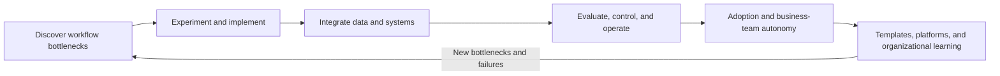

# Review of Public AX Engineer Roles

> Previous research baseline: 2026-07-23
> Sources checked: 2026-10-26. An undated posting is not evidence of a change after the baseline.

## Purpose

`AX Engineer` is not yet a title with one settled scope. This document examines recurring responsibilities and differences in historical and current public job and practitioner materials, then explains what this roadmap includes.

It does not treat one company's definition as a standard or claim statistical representation of the entire hiring market. Public materials may change or expire, so each source includes a link and verification date.

## Review criteria

- Whose workflow problem does the role start from?
- How far does it implement and operate directly?
- How does it handle data, systems, and permissions?
- How does it evaluate model and agent quality?
- Does it own adoption and role change?
- How does it reuse learning from one case?

## Role shapes found in public materials

### 1. Domain-embedded

FuriosaAI's Compiler AX Engineer posting describes a role embedded in a specific engineering team. It identifies bottlenecks in development, review, debugging, CI, and documentation; tests AI tools in the real workflow; and turns results into repeatable tools and playbooks. It tracks workflow measures such as pull-request cycle time, review time, issue-triage time, and CI flakiness—not only adoption.

Important competencies in this shape:

- observing domain work directly and structuring bottlenecks;
- comparing tools with real baselines rather than feature lists;
- operating team-specific templates, integrations, and guidance;
- viewing training and adoption metrics alongside technical outcomes.

Source:

- [`PRIMARY_OFFICIAL` FuriosaAI, Software Engineer, Compiler (AX Engineer)](https://furiosa.ai/career/software-engineer-compiler-ax-engineer-4005376201) (checked 2026-10-26; publication date unknown)
- The Ashby address was used in the 2026-07-23 review. It returned a JavaScript notice during research and 404 in the later PR check. Its [historical URL and access record](hiring-signals.md#j001) are retained; the company page above supplies current role content.

### 2. Organizational operating foundation

Lunit's Senior AX Engineer posting, read on 2026-07-23, frames approval flows, internal-policy questions, collaboration-tool and data connections, and workflow SDKs and runtimes as one organizational operating foundation. Rather than having one team build every application, it aims to let non-engineering functions create workflows within approved boundaries.

Important competencies in this shape:

- connecting data, identifiers, and permissions across systems of record;
- defining shared contracts for agent execution, evaluation, approval, audit, and recovery;
- building SDKs, templates, and runtimes for adding new workflows;
- setting the boundary between central foundations and team autonomy;
- treating security, governance, and operations as part of implementation.

Source:

- [`PRIMARY_OFFICIAL` Lunit, Senior AX Engineer](https://apply.workable.com/lunit/j/E3C22F589F/) (content read 2026-07-23; access checked 2026-10-26)
- The original company URL now redirects to `not_found=true`, and the [remaining recruitment-platform listing](https://recruit.wanted.co.kr/wd/368564) is marked closed. This document preserves the historical role description. Closure does not establish that the team disappeared or demand declined.

### 3. Business-team autonomy and adoption

A public post from Rapport Labs' AX team describes helping employees resolve real blockers through usage sessions and one-on-one support. The focus is not a tool introduction by itself, but a real workflow problem and the user's ability to solve the next problem independently.

This roadmap derives the following competencies from that case:

- separating reasons for non-use into technical, workflow, trust, and accessibility problems;
- operating office hours, guides, examples, and support channels;
- designing safe boundaries within which business teams may build or edit;
- recording recurring blockers as candidates for improving guidance, support, or technical foundations.

Source:

- [`PRIMARY_OFFICIAL` Rapport Labs, 월간 AX: AI를 실제로 쓰게 만들려면?](https://blog.rapportlabs.kr/%EC%9B%94%EA%B0%84-ax-ai%EB%A5%BC-%EC%8B%A4%EC%A0%9C%EB%A1%9C-%EC%93%B0%EA%B2%8C-%EB%A7%8C%EB%93%A4%EB%A0%A4%EB%A9%B4-156677) (published 2026-04-10; checked again 2026-10-26)

## Additional evidence checked on 2026-10-26

These are purpose-selected qualitative examples of responsibilities. The [27 posting records](hiring-signals.md) preserve role content, requirements, and recruitment signals: 11 open, eight closed, and eight unknown as checked on 2026-10-26. FuriosaAI and POSTECH remain unknown because their role-specific application routes could not be confirmed, despite readable job content.

Channels without a confirmed original-ID match remain separate records. These 27 records are not a unique-vacancy count and do not support hiring-growth, average-pay, or market-size estimates. Only GM has a verified publication date after 2026-08-01; the other 26 records are undated.

| Category | Source and date | Finding and limit |
|---|---|---|
| Published after the baseline | [GM, Sr. AI/Automation Engineer, HR Technology](https://search-careers.gm.com/en/jobs/jr-202605425/sr-ai-automation-engineer-hr-technology-remote-india-night-shift/) (posted 2026-09-21) | Integrates ServiceNow and Workday for HR, with requirements, testing, deployment, and security responsibilities. This is internal workflow transformation without an AX title. |
| Published after the baseline | [Anthropic, Claude Frontier Academy](https://www.anthropic.com/news/claude-frontier-academy) (announced 2026-10-02) | A simulated enterprise deployment and practical assessment precede a 12-week real project at the participant's organization and another assessment. Training 10,000 engineers by the end of 2027 is a target, not a completed result. |
| Current signal; publication date unknown | [OneSpan, AI Automation Engineer](https://www.onespan.com/about/careers/job/ai-automation-engineer-8278879?gh_jid=8278879&langcode=en) | Observes R&D work, prioritizes by frequency and cost, chooses agents or scripts, and hands ownership to the team. Finding it now does not establish when the role was created. |
| Current signal; publication date unknown | [Anthropic, Staff Software Engineer, GTM AI Engineering](https://job-boards.greenhouse.io/anthropic/jobs/5390966008) | Owns internal sales agents, evaluation, approval, monitoring, and shared-code quality. The older search title `GTM Claudification` is an alias for the current official role. |
| Current signal; publication date unknown | [Anthropic, AI Operations Engineer, Partnerships](https://job-boards.greenhouse.io/anthropic/jobs/5391151008) | Builds workflows on the portal and data model owned by a systems lead. Writes back to systems of record and designs human review, failure handling, and reuse. |
| Recruitment-platform evidence | [Daewoong, AX Engineer](https://recruit.wanted.co.kr/wd/390449), [Senior AX Engineer](https://career.rememberapp.co.kr/job/posting/344926) | Separates PM validation, engineer implementation/evaluation/operational transition, and senior technical choices/reviews/coaching. The employer ATS original and first publication dates are unverified. Remember shows closure on 2026-10-25; Wanted’s rolling wording alone does not confirm current applications. Original-ID identity across channels is unverified. |

All linked material in the table was read on 2026-10-26. Publication and current access status are separate facts. This small, selected sample cannot establish how prevalent a responsibility is across the market. Rereading pre-baseline material, such as the Rapport Labs article, is not a new market change.

### Compare adjacent roles by their working relationships

| Role and source | Working relationship and responsibility | Use in this roadmap |
|---|---|---|
| [OpenAI, Forward Deployed Engineer, Seoul](https://openai.com/careers/forward-deployed-engineer-seoul-seoul-south-korea/) | Owns discovery, implementation, production deployment, and adoption with external customers. | Compare shared competencies while keeping customer contracts and handoff responsibilities distinct. |
| [Anthropic, Staff Forward Deployed Engineer](https://job-boards.greenhouse.io/anthropic/jobs/5449229008) | Owns customer technical strategy, security/procurement gates, implementation, and operational handoff. | An example of a transition grounded in production-software experience and agent practice. |
| [Anthropic, Applied AI Architect, Seoul](https://job-boards.greenhouse.io/anthropic/jobs/5390735008) | Explicitly a pre-sales role supporting technical discovery, evaluation, and architecture. | Do not classify it as the same job as an internal workflow operator or implementation owner. |

These three postings were checked on 2026-10-26; publication dates are unknown. `Forward Deployed Engineer` and the Academy's `Frontier Deployed Engineer` are distinct names. The Academy also trains engineers inside customer and partner organizations, so the abbreviation `FDE` alone does not determine whether work is internal or customer-facing.

### Decisions for the learning path

- Retain the responsibility model linking the workflow problem, implementation, operations, adoption, and reuse.
- Identify which decisions belong to a PM, workflow engineer, shared-foundation owner, technical lead, and security owner.
- Review evaluation results, writes to systems of record, escalation records, and operational handoff alongside tool experience.
- Add an entry assessment and an unfamiliar evaluation scenario to the 12-week path. Record simulation results separately from real organizational operation.
- Distinguish bounded improvement work early in a career from full operational ownership. A vacancy's years-of-experience requirement is not a universal proficiency grade.

## Recurring responsibilities

The original three sources differ in organization, domain, and seniority, but the following loop recurs.

Shared responsibilities:

1. Verify the workflow problem and baseline before applying AI.
2. Connect prototypes to real systems and permission structures.
3. Operate execution, approval, incidents, and cost—not only model output.
4. Treat training and documentation as part of adoption, not an add-on.
5. Preserve each solution as templates, playbooks, SDKs, or shared foundations.

## Differences

| Difference | Domain-embedded | Organizational operating foundation | Business-team autonomy and adoption |
|---|---|---|---|
| First users | A specific domain team | Multiple functions and internal builders | Employees starting or blocked in AI use |
| Main deliverables | Workflow-specific tools, integrations, and playbooks | Data, execution, evaluation, and permission foundations | Guides, support systems, and reusable cases |
| Representative risk | Local optimization and duplicate implementation | Platform-first thinking and over-abstraction | Mistaking training volume for workflow change |
| Scaling path | Reuse patterns in adjacent workflows | Shared contracts and self-service | Business-team autonomy and fewer recurring support requests |

One job posting may include all three shapes. The table is not intended to split the role into three jobs; it shows which responsibilities receive emphasis.

The three operating models in the [role model](../roadmap/role-model.md) describe where an AX Engineer sits in an organization. The three shapes in this document describe which responsibilities public materials emphasize. They are independent and may be combined.

## Editorial decisions for this roadmap

### Focus on internal AX

This repository does not cover career tracks that deploy a product into external customer environments. Even when the technology overlaps, organizational relationships, success criteria, reuse paths, and handoff responsibilities differ.

### Organize learning around deployment responsibility

Prompting, RAG, agents, and automation tools are necessary competencies, but they do not describe the entire role. Learning should follow one workflow from problem discovery through operations, adoption, and standardization, with reviewable results at each stage.

### Separate individual proficiency from organizational maturity

One excellent person producing a successful case does not mean the organization has transformed. Individual proficiency, the eight-stage transformation of one workflow, and organizational AX maturity remain separate maps.

### Define the shared harness as common work rules

The roadmap does not force one model, framework, or UI. It aligns systems of record, inputs, outputs, validation, approval, records, permissions, and recovery so workflows can work together. A structure is not promoted to an enterprise standard until reuse has been demonstrated in a second workflow.

### Do not treat job postings as permanent truth

A job posting reflects one organization's needs at one point in time. The roadmap uses it alongside practitioner cases, operating artifacts, and contributor counterexamples—not as the only source for defining the role.
