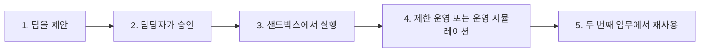

# AX 엔지니어 실습 프로젝트

다섯 프로젝트를 순서대로 진행한다. 단계가 올라갈수록 필요한 권한과 배포·복구·인수인계 책임을 더 확인한다. 실습 통과가 실행 권한을 부여하지는 않으며 환경·대상별 승인은 따로 받는다. 앞 프로젝트의 통과 근거 없이 실제 시스템을 변경하는 권한이나 AI의 자동 실행 범위를 넓히지 않는다.

## 프로젝트 순서

| 단계 | 프로젝트 | 실행 범위 | 확인할 결과 |
|---|---|---|---|
| 1 | [안전한 보조 도구](01-safe-assistant.md) | 공개·합성 데이터, 외부 실행 없음 | 평가 세트, 출처, 거절 |
| 2 | [담당자 승인 워크플로우](02-human-approved-workflow.md) | 제안 후 승인된 실행만 기록 | 승인 기준, 변경 전후, 감사 기록 |
| 3 | [샌드박스 통합](03-sandbox-integration.md) | 테스트 시스템 읽기·쓰기 | 권한 분리, 중복 방지, 복구 |
| 4 | [운영 파일럿](04-production-pilot.md) | 제한된 실제 업무 또는 격리된 운영 시뮬레이션 | SLO, 실제·모의 사용 구분, 장애, 인수인계 |
| 5 | [두 번째 업무 재사용](05-second-workflow-reuse.md) | 확인한 실행 규칙과 도구의 재사용 | 재사용 비교, 버전·공통화 결정 |

## 두 가지 수행 방식

### 조직 실전

실제 업무 책임자와 사용자가 참여하고 조직의 테스트·운영 환경과 승인 절차를 사용한다. P1은 이 트랙에서도 공개·합성 데이터만 사용하고 외부 변경을 하지 않는다. 이후 단계에서 조직 데이터를 사용할 때는 현재 정책과 담당자 승인을 따르며 P3는 테스트 환경, P4 실전은 승인된 운영 환경으로 구분한다.

### 공개 시뮬레이션

공개·합성 데이터와 격리된 환경을 사용한다. 가정, 시험 범위, 실제로 검증하지 못한 부분을 공개한다. 실제 운영 환경에서의 사용, 조직 성과, 공식 절차 변경을 주장하지 않는다.

개발 환경이 없다면 문서, 표, 노코드 샌드박스, 수동 시뮬레이션으로 같은 판단 과정을 연습할 수 있다. 문서 검토와 실행한 시험을 구분하고 실제 외부 실행이 없었다는 점을 명시한다. 실행·복구를 시험하지 않은 문서만으로 P3나 P4 시뮬레이션을 통과하지 않는다.

P1~P3의 통과 근거를 확인한 뒤 P4에서 조직 실전 또는 공개 시뮬레이션을 고른다. 시뮬레이션도 실패·중단·복구와 독립 검수를 실제로 수행해야 한다. [P4의 트랙별 판정](04-production-pilot.md)을 마치면 같은 근거 범위에서 P5로 이어가며 조직 운영 성과로 승격하지 않는다.

## 대표 사례 5개의 실습 경로

[업무별 적용 사례](../case-studies/README.md)는 같은 P1~P5 통과 기준을 서로 다른 업무와 시스템에 적용한다. 아래 표는 구조가 다른 대표 사례 5개만 보여 주며, 15개 사례의 설계 범위, 일부 기능을 구현한 단계와 근거 수준은 사례 인덱스와 `case.json`에서 확인한다. `implemented_project_stages`는 일부 기능의 구현 여부이며 해당 P단계 전체의 통과 판정이 아니다.

| 사례 | P1 보조 | P2 승인 | P3 샌드박스 | P4 제한 운영 | P5 재사용 |
|---|---|---|---|---|---|
| [Beauty/D2C VOC](../case-studies/beauty-d2c-voc/README.md) | 분류·요약 | 업무 제안 | 업무 생성 | — | 다른 시장·채널 비교 |
| [파일·CSV → AX Hub](../case-studies/file-csv-to-ax-hub/README.md) | 자료 정리 | Hub 반영 검수 | 구조화 저장 | — | 두 번째 자료 흐름 비교 |
| [Slack 회의 기록에서 승인할 후속 업무 찾기](../case-studies/slack-meeting-actions/README.md) | 회의 전 요약 | 할 일 승인 | 업무 생성 | 제한된 팀 | 두 번째 회의 유형 |
| [여러 업무가 함께 쓰는 메일 보조](../case-studies/centralized-mail-assist/README.md) | 분류·답장 초안 | 발송 승인 | 테스트 메일함 | 선택한 공용 메일함 | 두 번째 메일 업무 |
| [여러 업무를 위한 에이전트 운영 기반](../case-studies/company-agent-operating-layer/README.md) | 기존 결과 사용 | 공통 정책 판정 | 분리된 실행 환경 | 두 업무 제한 운영 | 공통화·폐기 결정 |

`—`는 해당 사례의 설계 경로에 P4가 포함되지 않는다는 뜻이다. 같은 행의 P5 항목도 학습 방향이며 완료나 P4 면제를 뜻하지 않는다. P5 실행 검증으로 이어가려면 먼저 P1~P3와 P4 실전 또는 시뮬레이션의 통과 근거를 준비한다. 선택한 사례가 P4를 다루지 않으면 별도 실습으로 채운다. 다른 업무의 P4 근거를 활용할 때는 [P5 진입 조건](05-second-workflow-reuse.md)에 따라 이번 업무에 적용할 수 있는 범위와 새로 시험할 조건을 확인한다.

Beauty/D2C VOC의 합성 입력 16건은 공개 데모의 재현 범위다. P1은 최소 20개 평가 사례와 개발에 쓰지 않은 입력의 독립 검수 등 전체 기준을 요구한다. 데모 실행이나 단위 테스트 통과로 P1 전체 통과를 대신하지 않는다.

## 새 시나리오로 확인하기

평가자는 개발에 쓰지 않은 입력과 예외를 골라 판정 기준을 먼저 정한다. 구현자는 모델·프롬프트·도구·정책 버전을 고정하고 평가를 받는다. 첫 실행 결과와 실패 기록은 수정 전에 보존한다.

구현에 참여하지 않은 사람이 결과를 판정하고 사용자는 업무 품질, 운영자는 중단·복구, 책임자는 허용 범위와 비용을 따로 검수한다. 한 사람이 여러 역할을 맡으면 이를 밝히되 구현자가 자신의 완료 여부를 단독으로 판정하지 않는다. 독립 검토자를 구하지 못하면 자기 점검 결과만 남기고 통과 판정은 보류한다.

실패를 고친 뒤에는 해당 실패와 기존 평가 세트를 다시 확인한다. 정답을 이미 본 사례만 반복하지 않고 같은 실패 유형의 새 시나리오도 평가한다. 평가 기록에는 수행 환경, 판정자 역할, 사용한 버전, 최초 결과와 재평가 결과를 함께 남긴다.

이 문서의 P1~P5는 실습 경로다. 표에 적힌 기능이나 추가된 평가 항목이 구현됐다는 뜻은 아니다. 현재 공개 구현 단계와 근거 수준은 각 사례의 `case.json`과 실행 기록으로 확인한다.

## 모든 프로젝트의 공통 제출물

- 문제, 사용자, 기준선
- 현재·목표 업무 흐름
- 범위, 이번 범위에서 제외한 목표, 금지 행동
- 데이터 출처·소유자·누락
- 입력·출력·평가·승인·기록·복구 규칙
- 정상·경계·실패 사례와 결과
- 결정·변경·실패 기록
- 성과, 한계, 주장하지 않는 내용

도구:

- [실험 카드](../toolkit/experiment-card.md)
- [업무 실행 규칙](../toolkit/execution-contract.md)
- [근거 기록](../toolkit/evidence-ledger.md)
- [사례 문서](../toolkit/case-study-template.md)
- [캡스톤 설계 점검표](../research/ax-failure-cases.md#캡스톤-설계에-쓰는-점검표): 공개 실패·중단 사례 16건에서 뽑은 여덟 질문. 업무를 고른 직후 답하고 결과를 실행 규칙과 실험 카드에 옮긴다.

## 통과 규칙

프로젝트마다 통과 기준을 다른 사람이 확인한다. 구현자가 혼자 “완료”로 판정하지 않는다. 실패했더라도 중단 조건을 지켰고 다음 결정을 설명할 기록이 있다면 유효한 결과다.
