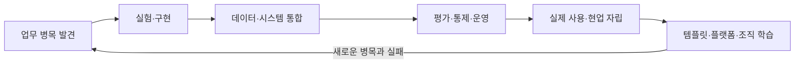

# AX Engineer 공개 역할 검토

> 기존 조사 기준일: 2026-07-23
> 이번 출처 확인일: 2026-10-26. 게시일을 알 수 없는 공고는 기준일 이후의 변화로 단정하지 않는다.

## 목적

`AX Engineer`는 아직 책임 범위가 하나로 굳어진 직함이 아니다. 이 문서는 과거와 현재의 공개 채용·현장 자료에서 반복되는 책임과 차이를 확인하고, 이 로드맵이 무엇을 포함할지 설명한다.

특정 회사의 정의를 표준으로 삼거나 채용 시장 전체를 통계적으로 대표한다고 주장하지 않는다. 공개 자료가 바뀌거나 공고가 종료될 수 있으므로 링크와 확인일을 함께 기록한다.

## 검토 기준

- 누구의 어떤 업무 문제에서 시작하는가
- 직접 구현하고 운영하는 범위는 어디까지인가
- 데이터·시스템·권한을 어떻게 다루는가
- 모델·에이전트 품질을 어떻게 평가하는가
- 실제 사용과 역할 변화를 책임지는가
- 한 사례의 학습을 어떻게 재사용하는가

## 공개 자료에서 확인한 역할 형태

### 1. 현업 밀착 실행형

FuriosaAI의 Compiler AX Engineer 공고는 특정 엔지니어링 팀 안에서 개발·리뷰·디버깅·CI·문서화의 병목을 찾고, AI 도구를 실제 흐름에서 실험한 뒤 반복 가능한 도구와 플레이북으로 남기는 역할을 설명한다. 도입률뿐 아니라 PR 주기, 리뷰 시간, 장애 분류 시간, CI 불안정성과 같은 업무 지표도 다룬다.

이 역할에 필요한 역량:

- 도메인 업무를 직접 관찰하고 병목을 구조화하는 능력
- 도구 도입 전의 업무 시간·오류·재작업과 도입 뒤 측정값을 비교하는 능력
- 팀별 템플릿·통합·가이드를 운영하는 능력
- 교육과 실제 사용 지표를 기술 결과와 함께 보는 능력

출처:

- [`PRIMARY_OFFICIAL` FuriosaAI, Software Engineer, Compiler (AX Engineer)](https://furiosa.ai/career/software-engineer-compiler-ax-engineer-4005376201) (2026-10-26 확인, 게시일 미상)
- 기존 Ashby 주소는 2026-07-23에 사용한 출처다. 이번 조사에서는 JavaScript 안내만 반환했고 이후 PR 검사에서 404를 확인했다. [과거 주소와 접근 기록](hiring-signals.md#j001)을 보존하며 현재 역할 내용은 위 회사 페이지를 따른다.

### 2. 조직 운영 기반형

2026-07-23에 확인한 Lunit의 Senior AX Engineer 공고는 승인 흐름, 사내 정책 질의, 협업 도구와 데이터 연결, 워크플로우 SDK·런타임을 하나의 조직 운영 기반으로 다룬다. 한 팀이 모든 앱을 만드는 대신 비개발 직군도 허용된 범위에서 워크플로우를 만들 수 있는 환경을 목표로 둔다.

이 역할에 필요한 역량:

- 여러 기준 시스템의 데이터 식별자를 맞추고 접근 권한을 유지하는 능력
- 에이전트 실행, 평가, 승인, 감사, 복구에 적용할 공통 실행 규칙
- 새 업무를 추가할 수 있는 SDK·템플릿·런타임
- 공통 기반에서 제공할 것과 각 팀에 맡길 것을 구분하는 능력
- 보안·거버넌스·운영을 구현과 함께 다루는 능력

출처:

- [`PRIMARY_OFFICIAL` Lunit, Senior AX Engineer](https://apply.workable.com/lunit/j/E3C22F589F/) (내용 확인: 2026-07-23, 접근 상태 확인: 2026-10-26)
- 기존 공식 주소는 이번 조회에서 `not_found=true`로 이동했고 [남아 있는 채용 플랫폼 공고](https://recruit.wanted.co.kr/wd/368564)도 마감을 표시한다. 이 문서에서는 과거 역할 설명으로 보존한다. 채용 종료만으로 팀이 없어졌거나 수요가 줄었다고 판단하지 않는다.

### 3. 현업 자립·확산형

Rapport Labs의 AX팀 공개 글은 구성원이 AI를 실제 업무에 쓰며 막히는 지점을 활용 세션과 일대일 지원으로 함께 해결하는 과정을 설명한다. 단순한 도구 소개보다 실제 업무 문제와 사용자가 스스로 다음 문제를 풀 수 있는 상태에 초점을 둔다.

이 로드맵은 이 사례에서 다음 역량을 도출한다.

- 사용하지 않는 이유를 기술·업무·신뢰·접근성 문제로 나눠 보는 능력
- 오피스아워, 가이드, 사례, 지원 채널을 운영하는 능력
- 현업이 직접 만들거나 수정할 안전한 범위를 설계하는 능력
- 반복해서 막히는 지점을 가이드·지원 방식·공통 기술의 개선 과제로 기록하는 능력

출처:

- [`PRIMARY_OFFICIAL` Rapport Labs, 월간 AX: AI를 실제로 쓰게 만들려면?](https://blog.rapportlabs.kr/%EC%9B%94%EA%B0%84-ax-ai%EB%A5%BC-%EC%8B%A4%EC%A0%9C%EB%A1%9C-%EC%93%B0%EA%B2%8C-%EB%A7%8C%EB%93%A4%EB%A0%A4%EB%A9%B4-156677) (발행: 2026-04-10, 이번 확인: 2026-10-26)

## 2026-10-26에 추가로 확인한 근거

아래 자료는 책임을 비교하기 위해 고른 정성 표본이다. [공고 기록 27개](hiring-signals.md)에서 원문 책임·요건과 모집 표시를 확인할 수 있다. 2026-10-26 기준 모집 표시 확인 11개, 마감 표시 확인 8개, 미확인 8개다. FuriosaAI와 POSTECH은 본문을 읽었지만 해당 직무의 지원 경로를 확인하지 못해 미확인으로 두었다.

채널 간 원 공고 ID가 연결되지 않으면 별도 기록으로 남긴다. 이 27개를 고유 채용 건수로 세지 않으며 채용 증가율, 평균 연봉, 시장 규모를 계산하지 않는다. 게시일이 2026-08-01 이후임을 확인한 공고는 GM 1개이고 나머지 26개는 게시일 미상이다.

| 구분 | 자료와 날짜 | 확인한 내용과 한계 |
|---|---|---|
| 기준일 이후 발표 | [GM, Sr. AI/Automation Engineer, HR Technology](https://search-careers.gm.com/en/jobs/jr-202605425/sr-ai-automation-engineer-hr-technology-remote-india-night-shift/) (2026-09-21 게시) | HR 조직의 ServiceNow·Workday 통합, 요구 분석, 테스트, 배포와 보안을 맡는다. AX라는 직함 없이 내부 업무 전환을 맡는 사례다. |
| 기준일 이후 발표 | [Anthropic, Claude Frontier Academy](https://www.anthropic.com/news/claude-frontier-academy) (2026-10-02 발표) | 모의 기업 배포와 실기평가 뒤 소속 조직의 실제 과제를 12주 수행하고 재평가한다. 2027년 말 1만 명 교육은 목표이며 완료 실적이 아니다. |
| 게시일 미상인 현재 신호 | [OneSpan, AI Automation Engineer](https://www.onespan.com/about/careers/job/ai-automation-engineer-8278879?gh_jid=8278879&langcode=en) | R&D 수작업의 빈도와 비용을 살펴 에이전트나 스크립트를 선택하고 팀이 직접 운영하도록 넘긴다. 이번에 확인했다는 이유로 새 직무가 생겼다고 보지 않는다. |
| 게시일 미상인 현재 신호 | [Anthropic, Staff Software Engineer, GTM AI Engineering](https://job-boards.greenhouse.io/anthropic/jobs/5390966008) | 사내 영업 에이전트, 평가, 승인, 운영 관측과 공유 코드의 품질을 맡는다. 검색에 남은 이전 제목 `GTM Claudification`과 현재 공식 제목을 같은 역할의 별칭으로 기록한다. |
| 게시일 미상인 현재 신호 | [Anthropic, AI Operations Engineer, Partnerships](https://job-boards.greenhouse.io/anthropic/jobs/5391151008) | 시스템 담당자가 관리하는 포털·데이터 모델 위에 업무 자동화를 만든다. 원본 시스템에 결과를 반영하고 위험 단계의 사람 검토, 오류 처리와 재사용을 설계한다. |
| 채용 플랫폼에서 확인 | [대웅, AX Engineer](https://recruit.wanted.co.kr/wd/390449), [Senior AX Engineer](https://career.rememberapp.co.kr/job/posting/344926) | PM의 과제 검증, 엔지니어의 구현·평가·운영 전환, 시니어의 기술 선택·리뷰·코칭을 나눈다. 기업 ATS 원문과 최초 게시일은 미확인이다. 리멤버는 2026-10-25 마감이며 원티드의 상시채용 문구만으로 현재 접수를 확정하지 않았다. 채널 간 원 공고 ID 대응은 미확인이다. |

표의 원문은 모두 2026-10-26에 확인했다. 게시일과 현재 접근 상태는 별개다. 표본이 적고 목적에 따라 고른 자료이므로 특정 책임이 시장 전체에서 얼마나 흔한지는 알 수 없다. 기존 라포랩스 글처럼 기준일 이전 자료를 다시 읽은 경우도 새 변화로 세지 않는다.

### 인접 직무는 업무 관계로 비교한다

| 역할과 출처 | 업무 관계와 책임 | 이 로드맵에서의 용도 |
|---|---|---|
| [OpenAI, Forward Deployed Engineer, Seoul](https://openai.com/careers/forward-deployed-engineer-seoul-seoul-south-korea/) | 외부 고객과 과제를 정의하고 구현·운영 배포·현업 적용을 맡는다. | 내부 AX와 공통 역량을 비교하되 고객 계약과 인수인계 책임을 구분한다. |
| [Anthropic, Staff Forward Deployed Engineer](https://job-boards.greenhouse.io/anthropic/jobs/5449229008) | 고객의 기술 전략, 보안·조달 조건, 직접 구현과 운영 인수인계를 맡는다. | 소프트웨어 운영 경험과 에이전트 실습을 함께 보는 경력 전환 사례로 참고한다. |
| [Anthropic, Applied AI Architect, Seoul](https://job-boards.greenhouse.io/anthropic/jobs/5390735008) | 공고가 명시한 역할은 pre-sales다. 고객의 기술 검토, 평가와 아키텍처를 지원한다. | 내부 업무 운영자나 구현 책임자와 같은 직무로 묶지 않는다. |

세 공고는 2026-10-26에 확인했으며 게시일은 미상이다. `Forward Deployed Engineer`와 Academy의 `Frontier Deployed Engineer`는 이름이 다르다. Academy는 고객사와 파트너 조직의 엔지니어도 교육하므로 약어 `FDE`만 보고 내부·외부 직무를 나누지 않는다.

### 학습 경로에 반영할 판단

- 업무 문제, 구현, 운영, 현업 적용과 재사용을 연결한 기존 책임 모델을 유지한다.
- PM, 업무 엔지니어, 공통 기반 담당자, 기술 리드와 보안 책임자가 각각 결정할 범위를 정한다.
- 도구 사용 이력과 함께 평가 결과, 원본 시스템 반영, 사람에게 넘긴 기록과 운영 인수인계를 확인한다.
- 12주 실습에서는 사전 역량을 확인하고 새 시나리오로 평가한다. 시뮬레이션 통과와 실제 조직 운영은 따로 기록한다.
- 경력 초반의 제한된 개선 업무와 전체 운영 책임을 구분한다. 한 공고의 연차 조건을 보편적인 숙련도 등급으로 쓰지 않는다.

## 반복해서 나타난 공통 책임

기존 세 자료의 조직·도메인·숙련도는 다르지만 다음 흐름은 반복된다.

공통 책임:

1. AI 적용 전에 업무 문제와 기준선을 확인한다.
2. 프로토타입이 실제 시스템을 읽고 승인된 권한만 사용하게 만든다.
3. 모델 출력뿐 아니라 실행·승인 이력을 추적하고 장애·비용을 관리한다.
4. 교육과 문서화로 현업이 새 절차를 계속 사용하고 직접 운영하게 한다.
5. 한 번의 해결을 템플릿, 플레이북, SDK, 공통 기반으로 남긴다.

## 서로 다른 부분

| 차이 | 현업 밀착 실행형 | 조직 운영 기반형 | 현업 자립·확산형 |
|---|---|---|---|
| 첫 번째 사용자 | 특정 도메인 팀 | 여러 부서와 내부 빌더 | AI 활용을 시작하거나 막힌 구성원 |
| 주된 산출물 | 업무별 도구·통합·플레이북 | 데이터·실행·평가·권한 기반 | 가이드·지원 체계·재사용 사례 |
| 대표 위험 | 국소 최적화와 중복 구현 | 플랫폼 우선과 과도한 추상화 | 교육 횟수를 업무 변화로 오인 |
| 확장 방식 | 인접 업무에서 패턴 재사용 | 공통 실행 규칙과 셀프서비스 | 현업 자립과 반복 문의 감소 |

하나의 채용 공고가 세 형태를 모두 포함하기도 한다. 이 표는 공개 자료가 어떤 책임을 강조하는지 비교하기 위한 기준이다.

[역할 모델](../roadmap/role-model.md)의 세 가지 운영 모델은 조직이 AX Engineer를 어디에 배치하는지를 다룬다. 이 문서의 세 형태는 공개 자료에서 어떤 책임이 강조됐는지를 다루므로 서로 독립적이며 조합할 수 있다.

## 이 로드맵의 편집 결정

### 조직 내부 AX를 범위로 둔다

이 저장소는 제품 회사가 외부 고객 환경에 솔루션을 배포하는 커리어 트랙을 다루지 않는다. 같은 기술을 쓰더라도 조직 관계, 성공 기준, 재사용 경로, 인수인계 책임이 다르기 때문이다.

### 도구보다 배포 책임을 학습 단위로 삼는다

프롬프트, RAG, 에이전트와 자동화 도구만으로는 직무 전체를 설명할 수 없다. 한 업무의 문제를 찾고 구현한 뒤, 실제 운영과 현업의 직접 사용, 표준화까지 확인한 결과를 학습 단위로 삼는다.

### 개인 역량과 조직 성숙도를 분리한다

뛰어난 한 사람이 사례를 만들었다고 조직 전체의 전환이 끝난 것은 아니다. 개인의 숙련도, 한 업무를 전환하는 8단계, 조직의 AX 성숙도를 구분해 확인한다.

### 공통 하네스는 함께 지킬 작업 규칙으로 정의한다

같은 모델·프레임워크·화면을 강제하지 않는다. 원본 데이터, 입력·출력, 검증, 승인, 기록, 권한, 복구 규칙이 서로 호환되게 한다. 두 번째 업무에서도 실제로 재사용한 결과를 확인한 뒤 전사 표준 여부를 결정한다.

### 채용 공고를 고정된 역할 정의로 보지 않는다

공고는 특정 시점과 조직의 필요를 반영한다. 역할 정의의 유일한 근거로 쓰지 않고, 현장 사례·운영 산출물·기여자의 반례를 함께 축적한다.
